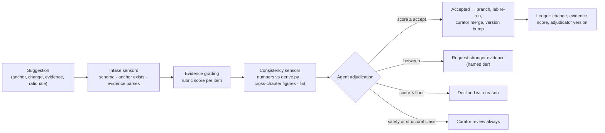

# PRD — Harness Bible Interactive

Sep 21, 2026 · @André

## Summary

Harness Bible Interactive turns the 41-chapter reference into a SaaS where readers navigate the content, ask a grounded assistant, run each chapter's lab in a browser IDE, and propose improvements that an agent adjudicates on the strength of the evidence submitted. The product is built on its own harness: the assistant, the IDE sandboxes, and the improvement agent are the book's components (intake, sensors, permissions, graders, gate, observability) applied to the book itself.

Four capabilities, one content model, one audit trail:

| Capability | What the user does | What the system guarantees |
| --- | --- | --- |
| Navigable content | Reads by part, chapter, layer; follows cross-references; searches | Every number links to its derive script or source row; every chapter shows its version |
| Assistant | Asks questions about the book and its labs | Answers cite chapter and section; refuses outside the corpus; never invents figures |
| Browser IDE | Runs, edits, and re-runs a chapter's lab | Ephemeral sandbox per session; reproduces the chapter's numbers or reports the diff |
| Agentic wiki improvement | Suggests a change with evidence | Evidence graded by a fixed rubric; an agent accepts, requests more, or declines; a curator can override; every change is versioned |

## Problem and goals

A static book on a field that moves monthly is stale on publication and cannot be tested by its readers. The Bible's claims are runnable (34 labs reproduce their chapters' numbers) and verifiable (every figure is derived, cited, or labelled illustrative), but a PDF hides both. Readers cannot run the labs, cannot ask the book a question, and cannot correct it when a price, a deadline, or a benchmark changes.

Goals, measurable at 12 months after launch:

| Goal | Target | Measure |
| --- | --- | --- |
| Readers use the book as a working reference, not a one-time read | 40% of active accounts return weekly | Weekly active / monthly active |
| Labs are run, not just read | 60% of chapters with a lab have ≥ 1 run per active account per quarter | Lab runs per account per chapter |
| Questions are answered from the book | ≥ 90% of assistant answers carry a chapter citation; < 2% flagged as wrong | Citation rate; user flags; sampled audit |
| The book improves from evidence | ≥ 200 accepted improvements; 0 accepted on weak evidence alone | Improvement ledger; adjudication audit |
| Content stays current | Every fast-moving figure (prices, deadlines, benchmarks) re-verified ≤ 90 days old | Verification-age report |

Non-goals: a general AI chat product; a hosted agent platform for customers' own use cases; user-generated chapters outside the book's structure; a marketplace.

## Users and personas

Four personas, matching the book's three reading paths plus the people who maintain it.

| Persona | Who | Primary use | Must have |
| --- | --- | --- | --- |
| Executive reader | CTO, CDO, ops VP at an industrial company | Part III, decision aids, the economics chapters; asks the assistant for a brief | Fast navigation to decision aids; exportable summaries with citations |
| Builder | Harness or platform engineer | Part II with labs open; runs, edits, re-runs; copies reference implementations | Browser IDE with the lab's full environment; diff against the chapter's numbers |
| Contributor | Practitioner, researcher, vendor engineer | Suggests corrections and additions with evidence | Suggestion form with evidence upload and grading feedback; visible adjudication |
| Curator | Editorial owner of a part | Reviews adjudications, overrides, releases versions | Queue, override with reason, version and release controls, audit export |

Accounts are organisational (a company buys seats) or individual. Contributors need an account with a verified identity; anonymous suggestions are not accepted, because provenance is part of the evidence.

## Capability 1 — Navigable content

The reader shows the book as it is structured: four parts, 41 chapters, nine layers per chapter, one lab per chapter, one registry per chapter, and a source tier on every figure.

Requirements:

- Navigation by part, chapter, and layer (Intuition through Sources); a persistent outline; keyboard shortcuts.
- Every cross-reference (ch12, 26.3, Lab 21) is a link that opens the target in place or in a side panel.
- Every derived number links to the line in its `derive.py` that produced it; every cited figure links to its source row; every illustrative figure is visibly labelled.
- Mermaid figures render; code blocks copy; the reference implementation of a chapter opens in the IDE with one click.
- Search across chapters, labs, and registries with filters by part, layer, source tier, and verification age.
- Each chapter shows its version, last verification date, VERIFY/REDTEAM status, and a link to its improvement history.
- Reading paths (Executive, Builder, Foundations) as curated sequences; bookmarks and notes per account.
- Portuguese and English editions of every chapter, with the source language marked; figures identical across editions.

Content is rendered from the book's Git repository at a pinned release; no content is edited in the SaaS outside the improvement flow.

## Capability 2 — Assistant

The assistant answers questions about the book, from the book, with citations, and refuses what the book does not cover. It is a retrieval-grounded agent built with the Bible's own retrieval, sensor, and grader components (ch20, ch26, ch27), not a general chat model.

Requirements:

- Every answer cites chapter and section for each claim; a claim with no citation is replaced by "the book does not cover this".
- Numbers in answers are copied from the chapter text or the derive script, never recomputed or estimated; the citation sensor verifies each quoted figure exists at the cited location.
- Scope: the book, its labs, its registries, and the cookbook map. Outside scope (vendor pricing today, a user's own system) the assistant says so and points to the chapter's measurement protocol.
- Modes: explain a section; compare two chapters' treatments; walk a decision aid with the user's inputs; explain a lab's output; draft an executive brief from Part III with citations.
- The assistant can open the IDE on a lab and read a run's results to explain a discrepancy.
- Refusals: no advice on operating control systems; no recomputation of the book's figures on the user's behalf without running the derive script; no answers on chapters not yet verified without saying so.
- Every conversation is logged with citations and sensor verdicts (ch29); a user can flag an answer, and flags feed the calibration set for the assistant's grader.
- Portuguese and English; answers in the user's language with citations to the matching edition.

## Capability 3 — Browser IDE for labs

Each chapter's lab opens in a browser IDE with the lab's files, a runner, and the chapter's expected numbers beside the run's output. The user can edit and re-run; the system reports what reproduced and what diverged.

Requirements:

- One ephemeral sandbox per session (microVM or container), created on open, destroyed on close; no persistent state except the user's saved edits, stored outside the sandbox.
- Egress default-deny; allow-list limited to package registries needed by the lab; no provider API access from user code unless the lab declares it and the user supplies their own key, which is never stored.
- Resource caps per session (CPU, memory, wall-clock); a lab's README states its expected runtime; over-cap runs are killed with a message.
- "Run" executes `derive.py` then `run.py`; the output pane shows the lab's REPRODUCED / NOT REPRODUCED verdict and a diff of each derived figure against the chapter's stated value.
- "Reset" restores the pinned lab files for the chapter's current version.
- Edited labs can be saved to the account, shared by link, and attached as evidence to an improvement suggestion.
- Labs that need a model (ch23's routing comparison, ch27's grader) run against a metered, capped allocation per account; the cap is enforced at the gateway (ch23), not by discipline.
- The IDE exposes the chapter's reference implementation for editing and the chapter text in a side panel.

Limits: no GPU labs in the browser tier (ch10, ch11 heavy variants run as downloads with instructions); no network to the user's own systems.

## Capability 4 — Agentic wiki improvement

A contributor proposes a change to a chapter with evidence; an agent grades the evidence against a fixed rubric, checks the change against the book's own rules, and accepts, requests more, or declines; a curator can override; every accepted change becomes a versioned edit with its evidence attached. The flow is the book's harness applied to the book: intake with a schema, deterministic sensors, a calibrated grader, a human gate for what the sensors cannot judge, and a hash-chained record.

The agent's score decides only what the rubric can decide; a curator decides the rest.

Requirements:

- Suggestion form: anchored to a chapter section, a figure, or a source row; the proposed text or number; at least one evidence item (link, DOI, upload, or a saved lab run); a rationale ≤ 200 words. Free-text suggestions with no anchor are rejected at intake.
- Evidence items are classified by the rubric (next section) and fetched or opened where possible; an evidence link that cannot be opened is graded as unverifiable, not as weak.
- Deterministic sensors run before any judgment: the anchor exists at the current version; a changed number is checked against `derive.py` (a derived figure can only change if the script changes with it); cross-chapter shared figures (scenario parameters, prices, benchmarks) are checked for consistency; the chapter lints after the change.
- The adjudication agent reads the suggestion, the graded evidence, the sensor verdicts, and the anchored text; it does not read the contributor's identity beyond verified/unverified. It emits a decision with a one-line reason per rubric criterion (ch27's structured-output rule).
- Decision classes: accept (evidence score at or above the accept threshold and all sensors pass); request more (score between floor and threshold — names the tier of evidence that would suffice); decline (below floor, or a sensor fails, with the failing sensor named).
- Always to curator review, regardless of score: changes to a chapter's structure, to the scenario's fixed parameters, to any safety or OT-boundary statement, to the rubric itself, and any suggestion that adds a new source tier.
- Accepted changes open a branch; the chapter's lab re-runs; the change merges only if the lab still reproduces (or the suggestion updated the lab and the new run reproduces); the chapter's version bumps by the book's rule (patch for wording and figures, minor for new sections, major for structure).
- Every decision is a hash-chained record: suggestion, evidence with grades, sensor verdicts, decision and reasons, adjudicator model and rubric versions, curator action. Contributors see their suggestion's full record.
- Curator override: accept a declined suggestion or decline an accepted one, with a coded reason; overrides are calibration data for the adjudicator (ch27), and an override rate above a floor on one criterion triggers a rubric review.
- Rate limits per contributor; a contributor whose suggestions are declined for unverifiable evidence three times in a month is throttled and told why.
- Contributors are credited in the chapter's improvement history; no edit is attributed to the agent.

## Evidence grading rubric

Evidence is graded by tier, then adjusted for relevance, recency, and independence; the suggestion's score is the strongest item's adjusted score, not the sum, so ten weak items never equal one strong one. The tiers extend the book's own source tiers (primary, vendor, analyst, practitioner, illustrative, derived, open).

| Tier | Examples | Base score |
| --- | --- | --- |
| A — Reproducible | A saved lab run in the IDE that reproduces the claimed change; a derive script diff; a runnable notebook with data | 100 |
| B — Primary published | Peer-reviewed paper; preprint with code; standard or regulation text; official specification; audited filing | 85 |
| C — Primary vendor | Official documentation, pricing page, changelog, release note, model card from the vendor concerned | 70 |
| D — Independent analyst | Independent benchmark (Artificial Analysis, Epoch, RouterArena-class); systematic review; regulator guidance | 60 |
| E — Practitioner | Named engineer's technical post with method and numbers; conference talk with slides; open-source repository with measurements | 40 |
| F — Reported | News article; secondary summary; textbook without primary citation | 25 |
| G — Opinion | Social media post; forum comment; unsourced blog; personal assertion | 5 |
| U — Unverifiable | Link cannot be opened; document not supplied; claim without artefact | 0 |

Adjustments, applied multiplicatively to the base score:

| Factor | Rule | Multiplier |
| --- | --- | --- |
| Relevance | Evidence addresses the anchored claim directly / partially / tangentially | 1.0 / 0.6 / 0.2 |
| Recency | For fast-moving figures (prices, deadlines, model versions, benchmarks): ≤ 90 days / ≤ 1 year / older | 1.0 / 0.7 / 0.3; stable facts unadjusted |
| Independence | Evidence from a party with no stake / the vendor concerned / the contributor's own employer | 1.0 / 0.8 / 0.7 |
| Corroboration | A second independent item at tier D or above | +10, once |

Decision thresholds (initial values; recalibrated quarterly against curator overrides):

| Change class | Accept ≥ | Floor (decline below) |
| --- | --- | --- |
| Wording, clarification, typo | 40 | 5 |
| Cited figure, date, price, deadline | 70 | 25 |
| Derived figure (requires a derive script change) | 100 (tier A only) | 100 |
| New claim or source row | 85 | 40 |
| Safety, OT-boundary, scenario parameter, structure | Curator always | — |

Worked examples:

- A contributor reports that the EU AI Act Annex III deferral date changed, attaching the Official Journal regulation text (B, direct, ≤ 90 days, independent): 85 × 1.0 × 1.0 × 1.0 = 85 ≥ 70 → accepted for the cited figure; the source row updates with the new verification date.
- A contributor says a routing paper's savings figure is wrong, attaching a screenshot of a social media thread (G): 5 → declined; the response names tier B or D as sufficient.
- A contributor claims Lab 22's repair cap should be four, attaching a saved IDE run showing the attempt histogram on their own golden set (A but partial relevance — their set, not the chapter's): 100 × 0.6 = 60 < 100 → request more: a run on the chapter's lab with the change applied.
- A vendor engineer submits their vendor's new cached-token price from the vendor's pricing page (C, direct, recent, vendor concerned): 70 × 1.0 × 1.0 × 0.8 = 56 < 70 → request more: an independent confirmation (D) adds +10 → 66, still short; a second vendor page is not independent. The curator may accept on inspection; the override is recorded.

The rubric is versioned and published in the product; changes to it are a curator-only class and are announced to contributors.

## Architecture

The product runs on the harness the book describes, component for component; the book's chapters are the design documents.

| Product component | Bible component | Role in the product |
| --- | --- | --- |
| Suggestion form; assistant question intake | Intake (ch17) | Schema, anchor resolution, clarification, scope refusal |
| Assistant, adjudicator, grader guides | Guides (ch18) | Versioned, byte-stable prefixes; per-class instructions |
| Book index (chapters, labs, registries, sources) | Retrieval (ch20) | Hybrid index with chapter version as the currency filter; citations by section id |
| Improvement and assistant workflows | Control plane (ch21) | Durable suggestion state; curator approval as a signal; timers |
| Adjudication and answer loops | Loop (ch22) | Plan · act · observe · verify · repair; caps |
| Model layer | Routing and gateway (ch23) | Small tier for grading and intake; frontier for adjudication; hard budget caps per account |
| Contributor and reader history | Memory (ch24) | Records only; no durable facts filed by the model |
| IDE sandboxes; evidence fetchers | Tools (ch25) | Ephemeral, egress-denied sandboxes; credentials never in the model |
| Anchor, number, consistency, lint checks | Sensors (ch26) | Deterministic gates before any judgment |
| Evidence and answer quality | Graders (ch27) | Isolated context; cross-family; quarterly κ against curators |
| Roles, evidence access, merge rights | Permissions (ch28) | Policy engine; curator-only classes; fail-closed |
| Ledger, audit export, dashboards | Observability (ch29) | Hash-chained decision records; per-account cost |
| Curator queue, overrides | Human-in-the-loop (ch31) | Routed by change class; seeded items; override rate |
| Rubric and threshold recalibration | Self-improving harness (ch32) | Overrides as calibration; quarterly threshold review; versioned rubric |

Content pipeline: the book's Git repository is the source of truth; a release pins a version; the SaaS renders from the pinned release; accepted improvements are pull requests merged by curators; the lab suite runs in CI on every merge (ch27's regression gate).

Deployment: multi-tenant web application; sandboxes on an isolated compute pool; model calls through a self-hosted gateway; Brazil data residency for accounts that require it (LGPD, ch36).

## Non-functional requirements

| Area | Requirement |
| --- | --- |
| Security | Sandboxes ephemeral, egress default-deny, resource-capped; no credential in any model-visible text (secret scanner at zero); policy engine fail-closed; SSO for organisational accounts |
| Privacy | LGPD compliance: purpose-limited account data; contributor identity retained for provenance with consent; assistant conversations retained 30 days as text, metadata thereafter; deletion on request |
| Cost control | Per-account model budget enforced at the gateway; IDE compute metered per session; adjudication cost per suggestion tracked; monthly cost per active account reported |
| Performance | Chapter load < 1 s; search < 500 ms; assistant first token < 2 s; sandbox ready < 5 s; adjudication decision < 10 min for automatic classes |
| Availability | 99.5% for reading and search; IDE and assistant 99%; adjudication is asynchronous with a 24-hour completion target |
| Accessibility | WCAG 2.2 AA; keyboard navigation; screen-reader labels on figures and code |
| Languages | Portuguese and English at parity for content, assistant, and UI; figures identical across editions |
| Auditability | Every adjudication, override, merge, and assistant answer is a chained record exportable per account and per chapter |
| Content integrity | Rendered content matches the pinned Git release by hash; the lab suite passes in CI before any release |

## Metrics and success criteria

Four headline numbers, reviewed monthly; the rest are leading indicators.

| Metric | Definition | Target at 12 months |
| --- | --- | --- |
| Weekly return rate | Accounts active in a week / active in the month | ≥ 40% |
| Lab run rate | Chapters with ≥ 1 lab run per active account per quarter | ≥ 60% of lab chapters |
| Assistant citation rate and flag rate | Answers with a chapter citation on every claim; answers flagged wrong by users or audit | ≥ 90%; < 2% |
| Adjudication precision | Accepted suggestions later reverted by a curator / accepted | < 3% |

Leading indicators: suggestions per month and their tier distribution; request-more conversion rate; curator override rate per rubric criterion (target < 10%; a criterion above 20% triggers a rubric review); adjudicator κ against curators (quarterly; retire a criterion below 0.6); verification age of fast-moving figures; cost per active account; sandbox kills per session; assistant refusal rate by cause.

What is not measured: time on page, messages per session, suggestions per contributor as a leaderboard — each rewards volume over evidence.

## Scope, phases, and release plan

Four phases, each shippable, each adding one capability on the previous one's harness.

| Phase | Ships | Gate to next |
| --- | --- | --- |
| 1 — Reader | Navigable content from the pinned release; cross-reference links; search; number-to-derive links; PT/EN editions; accounts | Book at 41/41 verified; render hash matches release; 20 pilot accounts |
| 2 — Assistant | Grounded Q&A with citations; refusals; conversation log; flagging | Citation rate ≥ 90% on a 300-question golden set; grader κ ≥ 0.7 against curators |
| 3 — IDE | Browser sandboxes; run/diff/reset; saved runs; metered model labs | All 34 labs reproduce in the sandbox tier; sandbox kill rate < 1%; cost per session within budget |
| 4 — Improvement | Suggestion intake; evidence grading; adjudication; curator queue; ledger; versioned merges | Adjudication precision < 3% on 100 curated suggestions; override rate < 10%; rubric published |

Out of scope for the first release: mobile apps; offline mode; customer-hosted deployment; suggestions that add chapters; GPU labs in the browser.

Dependencies: the book at 41/41 drafted and verified (currently 35 drafted, 34 labs reproducing); Portuguese editions; a curator roster of at least two per part; a self-hosted gateway and sandbox pool.

## Risks and open questions

| Risk | Mitigation |
| --- | --- |
| Evidence gaming: contributors cite tier-B sources that do not say what they claim | Relevance is graded by the adjudicator with the source opened, not from the citation; curators sample accepted tier-B items monthly; a contributor's misattribution is recorded and throttles their account |
| Rubric drift: thresholds tuned to what passes rather than what is right | Thresholds change only on quarterly override data; the rubric is versioned and public; a change is a curator-only class |
| Adjudicator bias toward fluent suggestions | Isolated context (suggestion, evidence, sensor verdicts, anchored text only); no contributor identity; quarterly κ with retirement below 0.6 |
| Book stale between releases | Verification-age report; fast-moving figures flagged in the reader when > 90 days; curators can hot-fix source rows with a patch release |
| Sandbox abuse (mining, egress attempts) | Egress default-deny; resource caps; kill and record; repeat offenders suspended |
| Assistant answers outside the book | Scope refusal by construction; citation sensor; flags to the calibration set |
| Cost overrun on model labs and adjudication | Hard caps at the gateway per account; adjudication cost per suggestion budgeted; tier-G suggestions declined at intake before any model call |
| Portuguese edition lag | Editions released together or not at all; figures identical by construction |

Open questions:

- Pricing model: seats per organisation, individual tier, or usage-metered IDE and assistant?
- Whether contributors receive compensation or recognition beyond credit in the improvement history.
- Which curator roster covers Part I foundations chapters, which need model-engineering review.
- Whether accepted improvements flow back into a print edition on a fixed cadence.
- Residency: Brazil-only hosting at launch, or a second region for EU customers.
