# Mermaid patterns for a TRD

Every diagram is Mermaid in a fenced ` ```mermaid ` block, so it renders in docs, GitHub and most wikis without a tool. Each pattern below is a skeleton with the conventions the TRD relies on; copy, rename, prune.

One rule for all of them: the diagram shows what exists, the paragraph after it states what cannot happen. A diagram without its invariant paragraph is decoration.

## C4 context (§2.1)

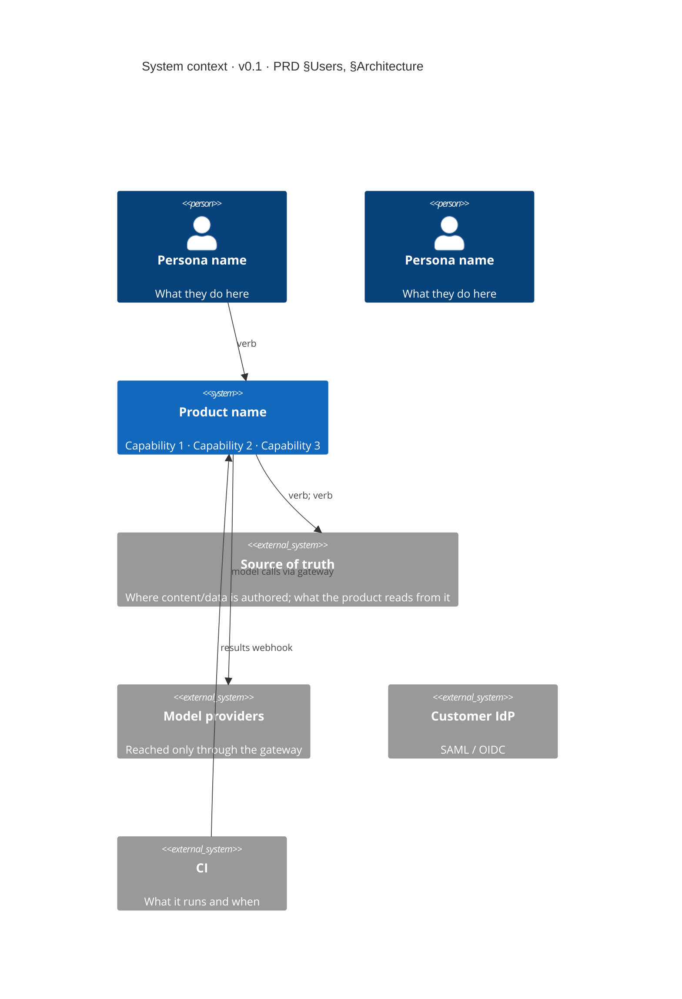

Conventions: one `Person` per PRD persona, no more; every `System_Ext` that appears here appears again as a conduit in §3.1; `Rel` labels are verbs, not nouns.

## C4 container (§2.2)

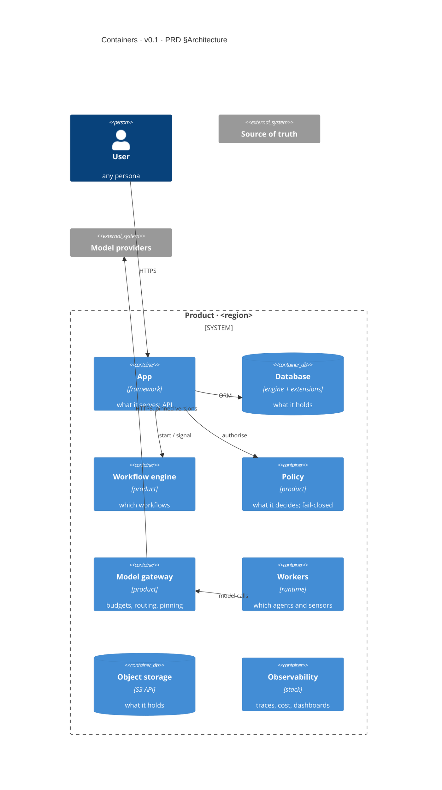

Conventions: the boundary name carries the region; the container count equals the count in §2's intro sentence; the `Rel` from workers to gateway (not from web) is the one that keeps provider credentials out of request threads — draw it that way when it is true, and say so in the paragraph.

## Deployment (§2.4)

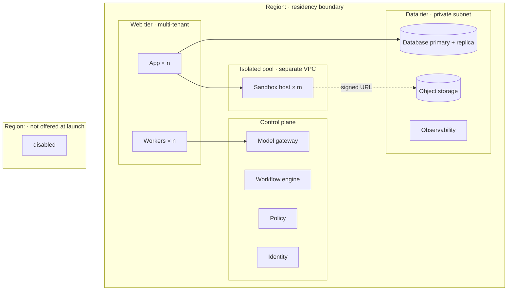

Conventions: a region the PRD mentions but does not ship is drawn with a `disabled` node, so the reviewer sees it was considered; a dotted edge marks the only path out of an isolated pool.

## Network topology (§3) and the riskiest path (§3.2)

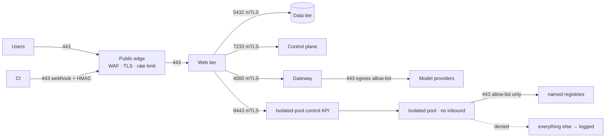

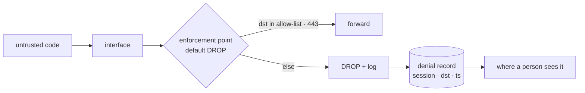

Conventions: every edge label carries port and auth; a dotted edge is a denial; the riskiest-path diagram ends at the place a human sees the denial.

## Entity–relationship (§4.1)

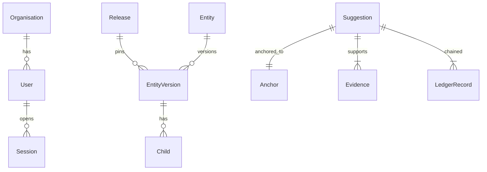

Conventions: labels are verbs or verb phrases; `||--||` for a required 1:1 that enforces a PRD rule (*no free-text suggestion* becomes a required `Anchor`); the bridge entity (the one that hangs off two domains) is named in the paragraph.

## Pipeline flowchart (§2.3, §4.5)

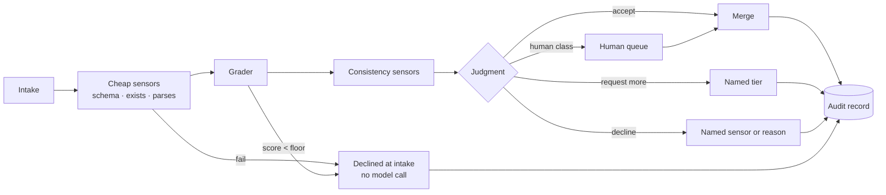

Conventions: cheap sensors before any model call; every outcome, including intake declines, reaches the audit record; the gate node (`{}`) is the one the paragraph's invariant is about.

## Sequence (§7)

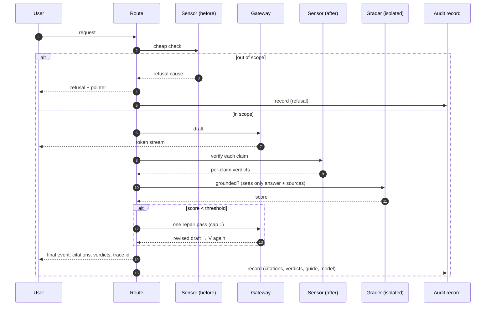

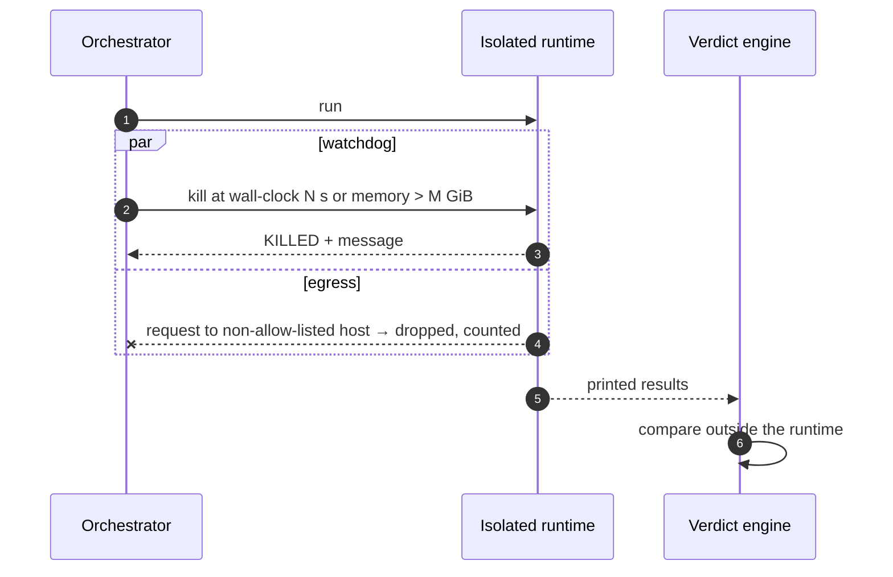

Conventions: `autonumber` always; `alt` for every failure branch; `par` for watchdogs; the cap is written in the message (`cap 1`); the isolated grader "sees only" what the paragraph says it sees; the verdict is computed outside the untrusted runtime.

## Authorisation (§6.2)

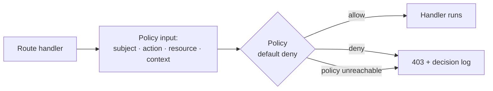

Convention: the `unreachable` edge is drawn, because fail-closed is a claim the diagram must make visible.

## Integrations (§7, last flow)

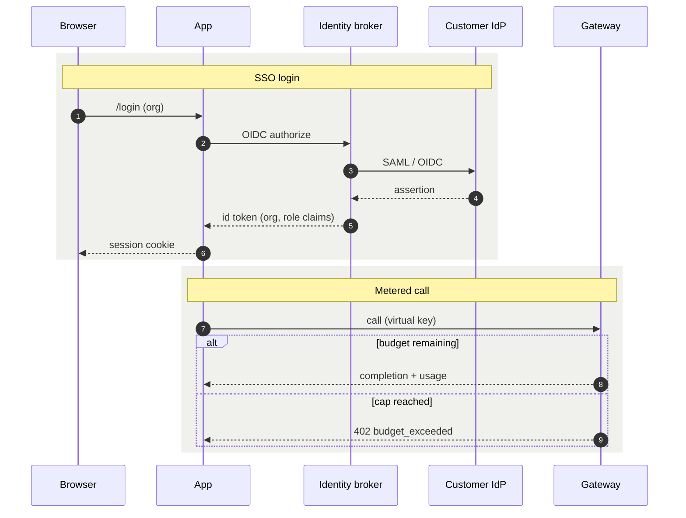

Convention: one `rect` per integration, each with one owner named in the paragraph (*identity is the broker's, budgets are the gateway's, state is the workflow engine's*).
