# TRD — Harness Bible Interactive

Sep 21, 2026 · @André · v0.1 · traces to PRD 2026-09-21 and UI package v0.9.0

## 1. Purpose, scope, phases

The product is the book's harness applied to the book. Each PRD phase adds one capability on the previous phase's components and must not pull forward components the next phase owns. Fixed stack: Next.js (App Router, RSC, TypeScript) and PostgreSQL via Prisma. Every other component is decided in section 2.2 with the book chapter it implements.

| Phase | Adds (architecture increment) | Must not need yet | Gate to next (PRD §Scope) |
| --- | --- | --- | --- |
| 1 — Reader | Content pipeline (Git release → rows, render hash); PostgreSQL + full-text and vector index; Next.js reader, search, paths; accounts and SSO; PT/EN editions | Gateway, workflow engine, sandboxes, adjudicator | Book at 41/41 verified; render hash matches release; 20 pilot accounts |
| 2 — Assistant | Model gateway with per-account hard caps; retrieval by section id; citation sensor; grader in isolated context; conversation log with sensor verdicts; flags | Sandboxes, workflow engine, curator queue | Citation rate ≥ 90 % on a 300-question golden set; grader κ ≥ 0.7 against curators |
| 3 — IDE | Sandbox orchestrator (microVM pool, egress default-deny, caps); run/diff/reset; saved runs in object storage; metered model labs through the gateway | Adjudicator, ledger, curator queue | All 34 labs reproduce in the sandbox tier; sandbox kill rate < 1 %; cost per session within budget |
| 4 — Improvement | Workflow engine for suggestion state; intake and consistency sensors; evidence grader; adjudicator; policy engine for curator-only classes; hash-chained ledger; curator queue; versioned merges via PR | — | Adjudication precision < 3 % on 100 curated suggestions; override rate < 10 %; rubric published |

Out of scope for the first release, per PRD: mobile apps, offline mode, customer-hosted deployment, suggestions that add chapters, GPU labs in the browser. The mobile Reader and Assistant screens in the UI package are responsive web, read-only, not apps.

Traceability rule for this document: every section names the PRD capability, non-functional row or screen it serves. A section that only restates the PRD is deleted.

## 2. C4 diagrams

One web application, one database, one gateway, one workflow engine, one sandbox pool. The book's chapters are the design documents; the table below fixes each non-stack component with its chapter.

### 2.0 Component decisions (PRD §Architecture)

| Component | Candidates | Pick | Why (≤ 5 lines) | Chapter |
| --- | --- | --- | --- | --- |
| Model gateway | LiteLLM (self-hosted) · Portkey | LiteLLM | Self-hosted in the residency region; per-key hard budgets enforced before the call; provider routing and version pinning; OTel export. Portkey is hosted outside Brazil. | ch23 |
| Workflow engine | Temporal (self-hosted) · AWS Step Functions | Temporal | Durable suggestion and answer workflows; curator approval as a signal; timers for the 24-hour target; idempotent activities. Lab 21 already runs on it, so the product runs on what the book teaches. | ch21 |
| Policy engine | OPA · Cedar | OPA | PDP as a sidecar next to the API; Rego policies in Git with the rubric; decision logs to the ledger; fail-closed by default deny. Cedar has no self-hosted decision log of the same maturity. | ch28 |
| Sandbox runtime | Firecracker microVMs · gVisor containers | Firecracker | Hard isolation per session; snapshot restore meets sandbox ready < 5 s; kernel-level egress rules; destroyed on close. gVisor shares the host kernel surface. | ch25 |
| Hybrid index | PostgreSQL pgvector + tsvector · OpenSearch | pgvector + tsvector | One datastore, one transaction, release id as a hard filter; hybrid = BM25-style rank fused with cosine rank; corpus is small (41 chapters, ~330 K words). OpenSearch adds a second store to keep in sync. | ch20 |
| Re-ranker | Small cross-encoder on gateway · none | Cross-encoder via gateway | Citation precision is the Phase 2 gate; re-rank top 40 to top 8 before drafting. | ch20 |
| Observability | OTel Collector + Langfuse + Grafana stack · Arize Phoenix | OTel + Langfuse + Grafana | OTel GenAI semantic conventions; Langfuse for model spans and cost; Grafana/Loki/Tempo for the rest; all self-hosted in region. | ch29 |
| Identity | Keycloak (OIDC/SAML broker) · Auth.js alone | Keycloak + Auth.js client | Org SSO needs SAML and OIDC brokering; Auth.js handles the Next.js session; contributor identity verification lives in Keycloak. | ch28 |
| Object storage | S3-compatible (MinIO) · cloud bucket | S3 API, region-pinned | Uploads, saved runs, audit packs, lab file snapshots. Any S3-compatible bucket in São Paulo. | ch29 |
| API style | REST + OpenAPI · tRPC | REST + OpenAPI (zod schemas shared) | Webhooks, audit export and the IDE transport need plain HTTP and a public contract; tRPC would leave a second contract for those. | ch17 |
| Code editor | CodeMirror 6 · Monaco | CodeMirror 6 | 300 KB smaller, keyboard-first, accessible; Monaco needs a worker bundle the CSP would have to allow. | — |

### 2.1 System context (PRD §Users and personas, §Architecture)

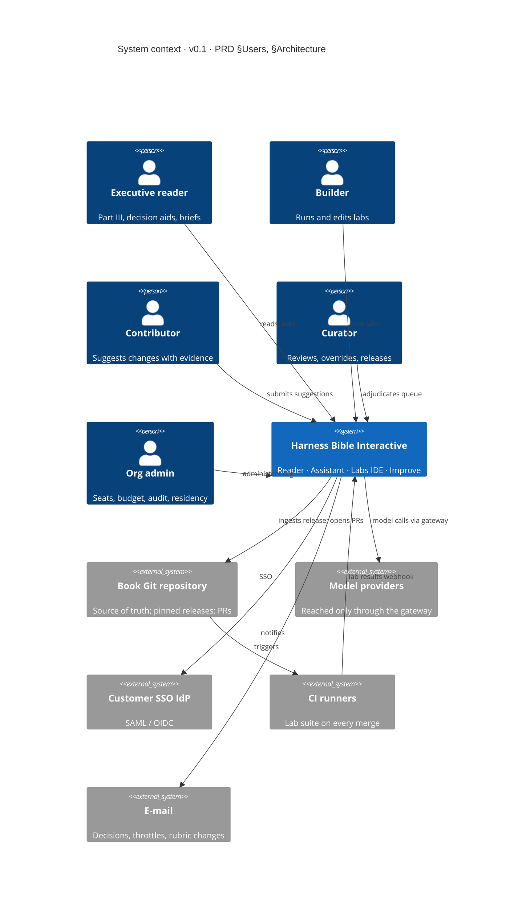

Five personas use one system. The Git repository is the only place content is authored; the SaaS renders a pinned release and returns accepted improvements as pull requests. Model providers are never called from the application directly.

### 2.2 Containers (PRD §Architecture, §Deployment)

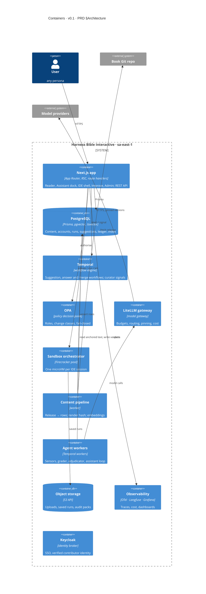

The Next.js app is the only container users reach. Agent workers, not the web tier, call the gateway, so a request thread never holds provider credentials. Sandboxes reach nothing inside the boundary except object storage through a signed URL.

### 2.3 Components per capability

| Capability | Components (in the Next.js app and workers) | PRD "must have" it carries | Screen |
| --- | --- | --- | --- |
| Reader (Cap. 1) | Outline resolver; section renderer (Mermaid, code, chips); cross-reference resolver (peek); derive-link resolver; search service (hybrid, filters); reading-path service; edition switch | Fast navigation; every number links to its derive line or source row; version and verification on every chapter; PT/EN parity | Book-Home, Reader-Chapter, Book-Paths, Book-Search, Mobile-Reader |
| Assistant (Cap. 2) | Intake and scope sensor; retriever (release filter); drafter; citation sensor; grader (isolated); refusal policy; decision-aid walker; conversation log; flag intake | Every claim cited; uncited claim replaced; refusals; log with sensor verdicts; flags feed calibration | Assistant-Answer, Assistant-Refusal-Walk, Mobile-Assistant |
| Labs IDE (Cap. 3) | Session manager; file service (pinned + user edits); runner (derive.py then run.py); diff engine (figure vs chapter value); verdict; kill watchdog; egress policy; model-lab meter | Ephemeral sandbox; REPRODUCED / NOT REPRODUCED and diff; reset; save, share, attach as evidence; caps enforced at the gateway | Labs-IDE |
| Improve (Cap. 4) | Intake sensors (schema, anchor exists, evidence parses); evidence fetcher and grader; consistency sensors (derive.py, cross-chapter, lint); adjudicator; change-class router; curator queue; override recorder; ledger writer; PR opener; version bumper | Anchored suggestions only; grading before judgment; decision classes; curator-always classes; hash-chained record; credit | Improve-Suggest, Improve-Adjudication, Improve-Record, Curator-Queue, Chapter-History, Rubric |

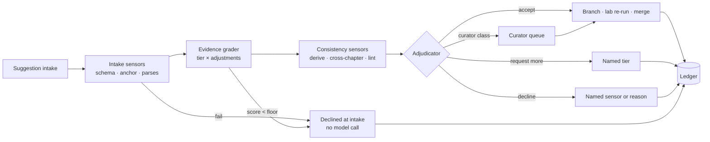

The Improve pipeline runs sensors before any judgment and writes every outcome, including intake declines, to the ledger. A tier-G suggestion never reaches a model.

### 2.4 Deployment (PRD §Deployment, §Non-functional · Privacy)

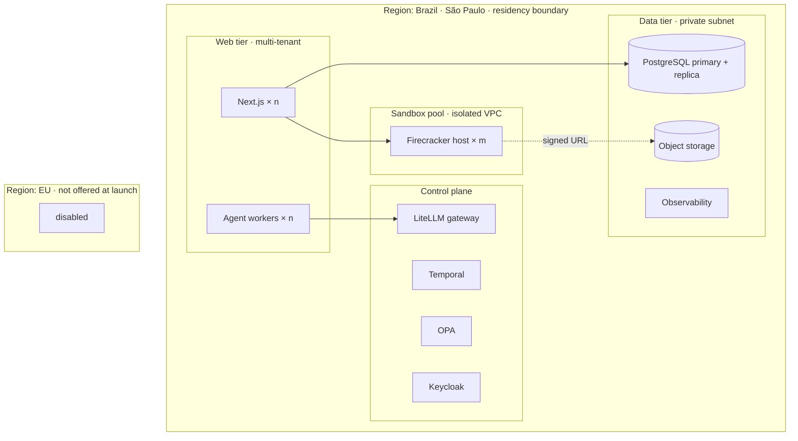

All tenants share the web and data tiers; isolation is by row-level `organisationId` and by OPA policy, not by deployment. The sandbox pool is a separate VPC with no route to the data tier. The EU region exists in the admin screen as a disabled option and in no infrastructure.

## 3. Network topology

Six zones, every conduit listed, sandbox egress default-deny. Nothing in the sandbox pool can reach the data tier, the gateway or a customer network (PRD §Capability 3, §Non-functional · Security).

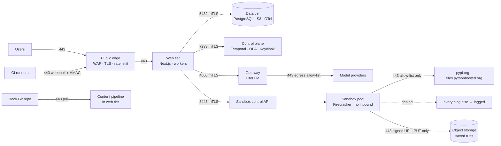

### 3.1 Conduits

| From | To | Protocol · port | Direction | Auth | Notes |
| --- | --- | --- | --- | --- | --- |
| Internet | Public edge | HTTPS 443 | in | none (TLS) | WAF, per-IP rate limit, HSTS |
| Public edge | Web tier | HTTPS 443 | in | edge-signed header | Only the edge can reach the web tier |
| Web tier | PostgreSQL | TCP 5432 | out | mTLS + role per service | Prisma; separate DB roles for app, pipeline, workers |
| Web tier | Object storage | HTTPS 443 | out | IAM role | Uploads, audit packs |
| Web tier | Temporal | gRPC 7233 | out | mTLS | Start, signal, query |
| Web tier | OPA | HTTP 8181 localhost | out | sidecar, no network | PDP runs beside every API pod |
| Web tier | Keycloak | HTTPS 443 | out | OIDC client secret (vault) | Session and identity |
| Agent workers | Gateway | HTTPS 4000 | out | per-account virtual key (vault) | The only path to a model |
| Gateway | Model providers | HTTPS 443 | out | provider key (gateway vault only) | Egress allow-list of provider hosts |
| Web tier | Sandbox control API | HTTPS 8443 | out | mTLS, service identity | create, exec, kill, snapshot |
| Sandbox | Package registries | HTTPS 443 | out | none | Allow-list: pypi.org, files.pythonhosted.org; per-lab additions declared in README |
| Sandbox | Object storage | HTTPS 443 | out | pre-signed PUT, 10-minute TTL | Saved run artefacts only |
| Sandbox | anything else | any | out | — | Denied at the host nftables; denial logged with session id |
| CI runners | Public edge | HTTPS 443 | in | HMAC-signed webhook | Lab suite results |
| Content pipeline | Book Git repo | HTTPS 443 | out | deploy key, read | Pull pinned release; push PR branches via a second write-scoped key |
| Web tier | E-mail | SMTP 587 / HTTPS | out | API key (vault) | Notifications |

### 3.2 Sandbox egress path

```mermaid
flowchart LR
  P[user code in microVM] --> T[TAP interface]
  T --> N{host nftables<br/>default DROP}
  N -->|dst in allow-list · 443| OK[forward]
  N -->|else| D[DROP + log]
  D --> L[(egress_denial\nsession_id · dst · ts)]
  L --> UI[IDE status bar<br/>"3 requests denied by allow-list"]
```

The microVM has one TAP interface; the host, not the guest, holds the rules. Denials are counted per session and shown in the status bar the Labs-IDE screen specifies, and repeated denial patterns feed the sandbox-abuse detection in section 10.

### 3.3 Residency boundary

All containers, storage, backups, observability data and the gateway run in São Paulo. Model providers are outside the boundary by nature; the gateway sends prompts and receives completions and stores neither outside the region. The admin screen's "EU region" option is disabled until a second deployment exists (PRD §Open questions).

### 3.4 Secrets and the model-visible surface

| Secret | Lives in | Reachable by | Model-visible |
| --- | --- | --- | --- |
| Provider API keys | Gateway vault | Gateway process only | No |
| Per-account gateway virtual keys | Web vault, injected into worker env | Agent workers | No |
| Database credentials | Web vault | App, workers, pipeline | No |
| Git deploy keys | Pipeline vault | Content pipeline | No |
| User-supplied provider key for a model lab | Sandbox env var for that session | User code in that sandbox | No; never stored, never logged |
| Signed URLs | Generated per request | Sandbox, browser | No |

Proof: the assistant, grader and adjudicator receive only fields listed in section 8 (anchored text, retrieved sections, suggestion payload, sensor verdicts). No environment variable, header or config object is serialised into a prompt. A secret scanner runs on every prompt template in CI and on every logged prompt at ingestion; the PRD's requirement is a scanner count of zero.

## 4. Data model

One PostgreSQL database, one Prisma schema, four domains: content (immutable per release), accounts, activity (conversations, runs), and improvement (suggestions and the ledger). Content rows are never updated in place; a new release inserts new versions.

### 4.1 Entity–relationship diagram (PRD §Capability 1–4, §Evidence rubric)

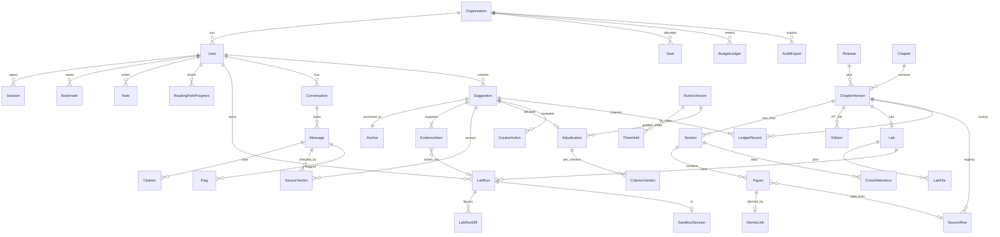

The diagram reads left to right from accounts to content to activity to improvement. `LedgerRecord` hangs off both `Suggestion` and `ChapterVersion` so a per-chapter export and a per-suggestion record come from the same rows.

### 4.2 Prisma schema

```prisma
generator client { provider = "prisma-client-js" }
datasource db { provider = "postgresql"; url = env("DATABASE_URL"); extensions = [vector, pg_trgm] }

// ---------- accounts ----------
enum Role { READER BUILDER CONTRIBUTOR CURATOR ORG_ADMIN }
enum Residency { BR_SAO_PAULO }

model Organisation {
  id            String   @id @default(uuid())
  name          String
  seatLimit     Int
  residency     Residency @default(BR_SAO_PAULO)
  ssoIssuer     String?
  tokenCap      BigInt   // monthly hard cap, enforced at the gateway
  ideMinutesCap Int
  createdAt     DateTime @default(now())
  users         User[]
  seats         Seat[]
  budget        BudgetLedger[]
  exports       AuditExport[]
}

model User {
  id               String  @id @default(uuid())
  organisationId   String?
  organisation     Organisation? @relation(fields: [organisationId], references: [id])
  email            String  @unique
  displayName      String
  role             Role    @default(READER)
  identityVerified Boolean @default(false)   // contributors must be true
  provenanceConsentAt DateTime?               // LGPD: identity retained for provenance with consent
  locale           String  @default("pt-BR")
  throttledUntil   DateTime?
  deletedAt        DateTime?                  // soft delete; ledger keeps a pseudonym
  sessions Session[]; bookmarks Bookmark[]; notes Note[]; progress ReadingPathProgress[]
  labRuns LabRun[]; conversations Conversation[]; suggestions Suggestion[]; curatorActions CuratorAction[]
  @@index([organisationId, role])
}

model Seat { id String @id @default(uuid()); organisationId String; organisation Organisation @relation(fields:[organisationId], references:[id]); userId String? @unique; assignedAt DateTime? @@index([organisationId]) }
model Session { id String @id; userId String; user User @relation(fields:[userId], references:[id]); expiresAt DateTime; idpSessionId String? @@index([userId]) }

// ---------- content (immutable per release) ----------
enum Part { P0 P1 P2 P3 P4 }
enum Layer { INTUITION MECHANISM WORKED_NUMBERS MEASUREMENT FAILURE FRONTIER INDUSTRIAL_APPLICATION DECISION_AIDS SOURCES }
enum SourceTier { PRIMARY VENDOR ANALYST PRACTITIONER ILLUSTRATIVE DERIVED OPEN }
enum Lang { EN PT }
enum VerifyStatus { PASSED FAILED UNVERIFIED }

model Release {
  id          String   @id            // e.g. "2026.09"
  gitSha      String   @unique
  renderHash  String                  // hash of all rendered content rows; must equal CI's
  publishedAt DateTime
  chapters    ChapterVersion[]
}

model Chapter { number Int @id; part Part; slug String @unique; versions ChapterVersion[] }

model ChapterVersion {
  id            String   @id @default(uuid())
  chapterNumber Int;     chapter Chapter @relation(fields:[chapterNumber], references:[number])
  releaseId     String;  release Release @relation(fields:[releaseId], references:[id])
  version       String   // semver: patch wording/figures, minor new section, major structure
  sourceLang    Lang
  verifyStatus  VerifyStatus
  redteamStatus VerifyStatus
  redteamOpen   Int      @default(0)
  verifiedAt    DateTime?
  contentHash   String
  sections      Section[]; editions Edition[]; lab Lab?; sourceRows SourceRow[]; ledger LedgerRecord[]
  @@unique([chapterNumber, version])
  @@index([releaseId])
}

model Edition { id String @id @default(uuid()); chapterVersionId String; chapterVersion ChapterVersion @relation(fields:[chapterVersionId], references:[id]); lang Lang; title String; body Json; @@unique([chapterVersionId, lang]) }

model Section {
  id               String @id            // "21.3"
  chapterVersionId String; chapterVersion ChapterVersion @relation(fields:[chapterVersionId], references:[id])
  layer            Layer
  ordinal          Int                   // 1..9
  titleEn          String; titlePt String
  bodyEn           String; bodyPt String // markdown; figures identical across editions
  tsv              Unsupported("tsvector")?
  embedding        Unsupported("vector(1024)")?
  figures          Figure[]; xrefs CrossReference[]
  @@unique([chapterVersionId, ordinal])
  @@index([chapterVersionId, layer])
}

model Figure {
  id           String @id             // "F-21-03"
  sectionId    String; section Section @relation(fields:[sectionId], references:[id])
  label        String
  value        Decimal
  unit         String?
  tier         SourceTier
  fastMoving   Boolean @default(false) // prices, deadlines, model versions, benchmarks
  scenarioParam Boolean @default(false) // P-101, 11 steps, 2,000/day: curator-only class
  sourceRowId  String?; sourceRow SourceRow? @relation(fields:[sourceRowId], references:[id])
  derive       DeriveLink?
  @@index([tier, fastMoving])
}

model DeriveLink { figureId String @id; figure Figure @relation(fields:[figureId], references:[id]); labId String; filePath String @default("derive.py"); line Int; expression String }

model SourceRow {
  id               String @id            // "21.9 r4"
  chapterVersionId String; chapterVersion ChapterVersion @relation(fields:[chapterVersionId], references:[id])
  ordinal          Int
  citation         String; url String?; doi String?
  tier             SourceTier
  verifiedAt       DateTime
  fastMoving       Boolean @default(false)
  figures          Figure[]
  @@unique([chapterVersionId, ordinal])
  @@index([verifiedAt])
}

model CrossReference { id String @id @default(uuid()); fromSectionId String; from Section @relation(fields:[fromSectionId], references:[id]); targetKind String; targetId String; @@index([targetId]) }

// ---------- labs ----------
enum Verdict { REPRODUCED NOT_REPRODUCED KILLED ERROR }
enum DiffStatus { MATCH DIVERGE NEW }

model Lab { id String @id; chapterVersionId String @unique; chapterVersion ChapterVersion @relation(fields:[chapterVersionId], references:[id]); expectedRuntimeS Int; wallClockCapS Int @default(600); cpu Int @default(2); memoryGiB Int @default(4); declaresModelCalls Boolean @default(false); egressExtra String[]; files LabFile[]; runs LabRun[] }
model LabFile { id String @id @default(uuid()); labId String; lab Lab @relation(fields:[labId], references:[id]); path String; sha256 String; storageKey String; @@unique([labId, path]) }

model LabRun {
  id          String  @id @default(uuid())
  labId       String; lab Lab @relation(fields:[labId], references:[id])
  userId      String; user User @relation(fields:[userId], references:[id])
  ordinal     Int                     // run 1, 2, 3 per user per lab
  verdict     Verdict
  editedFiles Json                    // [{path, sha256, storageKey}] stored outside the sandbox
  startedAt   DateTime; finishedAt DateTime?
  durationMs  Int?
  killReason  String?
  logKey      String?                 // object storage
  sharedToken String? @unique
  diffs       LabRunDiff[]; sandbox SandboxSession?; evidence EvidenceItem[]
  @@unique([labId, userId, ordinal])
}
model LabRunDiff { id String @id @default(uuid()); labRunId String; run LabRun @relation(fields:[labRunId], references:[id]); figureId String?; label String; chapterValue Decimal?; runValue Decimal?; status DiffStatus }
model SandboxSession { id String @id; labRunId String? @unique; run LabRun? @relation(fields:[labRunId], references:[id]); userId String; vmId String; createdAt DateTime @default(now()); destroyedAt DateTime?; readyMs Int; cpuPct Int?; memGiB Decimal?; egressDenials Int @default(0); modelTokens BigInt @default(0) }

// ---------- assistant ----------
enum SensorKind { SCOPE CITATION GROUNDING EDITION ANCHOR_EXISTS DERIVE_CONSISTENCY CROSS_CHAPTER LINT SCHEMA EVIDENCE_PARSES }
enum SensorResult { PASS FAIL WARN NA }
enum RefusalCause { OUT_OF_SCOPE CONTROL_SYSTEM_OPERATION RECOMPUTE_REQUEST UNVERIFIED_CHAPTER }

model Conversation { id String @id @default(uuid()); userId String; user User @relation(fields:[userId], references:[id]); releaseId String; chapterNumber Int?; sectionId String?; lang Lang; createdAt DateTime @default(now()); textPurgedAt DateTime?; messages Message[]; @@index([userId, createdAt]) }
model Message {
  id             String @id @default(uuid())
  conversationId String; conversation Conversation @relation(fields:[conversationId], references:[id])
  role           String   // user | assistant
  mode           String?  // explain | compare | walk | explain_run | brief
  text           String?  // null after 30-day purge
  refusalCause   RefusalCause?
  guideVersion   String?; modelId String?
  firstTokenMs   Int?; totalMs Int?; tokensIn Int?; tokensOut Int?
  traceId        String?
  createdAt      DateTime @default(now())
  citations Citation[]; verdicts SensorVerdict[]; flags Flag[]
}
model Citation { id String @id @default(uuid()); messageId String; message Message @relation(fields:[messageId], references:[id]); sectionId String; figureId String?; quoted String?; resolved Boolean }
model SensorVerdict { id String @id @default(uuid()); messageId String?; message Message? @relation(fields:[messageId], references:[id]); suggestionId String?; suggestion Suggestion? @relation(fields:[suggestionId], references:[id]); kind SensorKind; result SensorResult; detail Json; sensorVersion String; createdAt DateTime @default(now()) }
model Flag { id String @id @default(uuid()); messageId String; message Message @relation(fields:[messageId], references:[id]); userId String; reason String; createdAt DateTime @default(now()); inCalibrationSet Boolean @default(false) }

// ---------- improvement ----------
enum AnchorKind { SECTION FIGURE SOURCE_ROW }
enum ChangeClass { WORDING CITED_FIGURE DERIVED_FIGURE NEW_CLAIM CURATOR_ALWAYS }
enum EvidenceKind { LINK DOI UPLOAD LAB_RUN }
enum EvidenceTier { A B C D E F G U }
enum Decision { ACCEPT REQUEST_MORE DECLINE CURATOR_REVIEW }
enum SuggestionState { DRAFT SUBMITTED INTAKE_DECLINED GRADED SENSED DECIDED CURATOR_QUEUE MERGING MERGED CLOSED }

model Suggestion {
  id             String @id                // "S-15-0377"
  userId         String; user User @relation(fields:[userId], references:[id])
  chapterVersionId String
  changeClass    ChangeClass
  state          SuggestionState
  proposedText   String?; proposedValue Decimal?; proposedUnit String?
  rationale      String                     // ≤ 200 words, checked at intake
  score          Int?                       // strongest adjusted item + corroboration
  workflowId     String? @unique            // Temporal
  createdAt      DateTime @default(now())
  anchor Anchor?; evidence EvidenceItem[]; verdicts SensorVerdict[]; adjudication Adjudication?; curatorActions CuratorAction[]; ledger LedgerRecord[]
  @@index([state, changeClass])
}
model Anchor { suggestionId String @id; suggestion Suggestion @relation(fields:[suggestionId], references:[id]); kind AnchorKind; sectionId String?; figureId String?; sourceRowId String?; currentText String; existsAtVersion Boolean }
model EvidenceItem {
  id            String @id @default(uuid())
  suggestionId  String; suggestion Suggestion @relation(fields:[suggestionId], references:[id])
  kind          EvidenceKind
  url           String?; doi String?; storageKey String?
  labRunId      String?; labRun LabRun? @relation(fields:[labRunId], references:[id])
  fetchStatus   String                      // opened:200 | unreachable | not_supplied
  tier          EvidenceTier
  baseScore     Int
  relevance     Decimal                     // 1.0 | 0.6 | 0.2
  recency       Decimal                     // 1.0 | 0.7 | 0.3 | 1.0 (stable)
  independence  Decimal                     // 1.0 | 0.8 | 0.7
  adjustedScore Int
  gradedBy      String                      // model id or "intake-rules"
  ageDays       Int?
}
model Adjudication {
  suggestionId  String @id; suggestion Suggestion @relation(fields:[suggestionId], references:[id])
  decision      Decision
  score         Int; acceptAt Int; floorAt Int
  sufficientTier EvidenceTier?               // for REQUEST_MORE
  failingSensor SensorKind?                  // for DECLINE by sensor
  guideVersion  String; modelId String
  rubricVersionId String; rubric RubricVersion @relation(fields:[rubricVersionId], references:[id])
  decidedAt     DateTime
  criteria      CriterionVerdict[]
}
model CriterionVerdict { id String @id @default(uuid()); adjudicationId String; adjudication Adjudication @relation(fields:[adjudicationId], references:[suggestionId]); criterion String; verdict String; reason String }
model CuratorAction { id String @id @default(uuid()); suggestionId String; suggestion Suggestion @relation(fields:[suggestionId], references:[id]); curatorId String; curator User @relation(fields:[curatorId], references:[id]); action String; overrideCode String?; note String?; seeded Boolean @default(false); createdAt DateTime @default(now()); @@index([overrideCode]) }
model RubricVersion { id String @id; publishedAt DateTime; tiers Json; adjustments Json; thresholds Threshold[]; adjudications Adjudication[] }
model Threshold { id String @id @default(uuid()); rubricVersionId String; rubric RubricVersion @relation(fields:[rubricVersionId], references:[id]); changeClass ChangeClass; acceptAt Int?; floorAt Int?; @@unique([rubricVersionId, changeClass]) }

model LedgerRecord {
  seq              BigInt @id @default(autoincrement())
  suggestionId     String?; suggestion Suggestion? @relation(fields:[suggestionId], references:[id])
  chapterVersionId String?; chapterVersion ChapterVersion? @relation(fields:[chapterVersionId], references:[id])
  kind             String        // submitted graded sensors decided curator merged answer override export
  actor            String        // user pseudonym id | "adjudicator guide v2.1 rubric v1.2" | curator id
  payload          Json
  prevHash         String
  hash             String @unique
  createdAt        DateTime @default(now())
  @@index([chapterVersionId, seq])
}

// ---------- reader state, budget, audit ----------
model Bookmark { id String @id @default(uuid()); userId String; user User @relation(fields:[userId], references:[id]); sectionId String; createdAt DateTime @default(now()); @@unique([userId, sectionId]) }
model Note { id String @id @default(uuid()); userId String; user User @relation(fields:[userId], references:[id]); sectionId String; body String; updatedAt DateTime @updatedAt }
model ReadingPathProgress { id String @id @default(uuid()); userId String; user User @relation(fields:[userId], references:[id]); path String; lastSectionId String; completed Int; @@unique([userId, path]) }
model BudgetLedger { id String @id @default(uuid()); organisationId String; organisation Organisation @relation(fields:[organisationId], references:[id]); month String; kind String; ref String?; tokens BigInt @default(0); ideMinutes Int @default(0); costMicros BigInt @default(0); @@index([organisationId, month]) }
model AuditExport { id String @id @default(uuid()); organisationId String; organisation Organisation @relation(fields:[organisationId], references:[id]); scope String; fromSeq BigInt; toSeq BigInt; headHash String; storageKey String; createdAt DateTime @default(now()) }
```

Rules the schema enforces, with the PRD line each serves:

| Rule | Mechanism |
| --- | --- |
| A derived figure changes only with its derive script | `Figure.tier = DERIVED` requires a `DeriveLink`; `Threshold(DERIVED_FIGURE)` has `acceptAt = floorAt = 100`; the merge workflow refuses a `DERIVED_FIGURE` change whose branch does not touch `DeriveLink.filePath` |
| No free-text suggestion | `Anchor` is a required 1:1 on `Suggestion`; the intake sensor sets `existsAtVersion` and declines when false |
| Contributor identity retained with consent | `User.identityVerified` and `provenanceConsentAt` both required before `state` leaves `DRAFT`; a user delete sets `deletedAt` and the ledger keeps `actor` as a pseudonym |
| Scenario parameters and structure are curator-only | `Figure.scenarioParam = true` or `Anchor.kind = SECTION` on a structural change forces `changeClass = CURATOR_ALWAYS` at intake |
| Score is the strongest item, not the sum | `Suggestion.score` is computed as `max(EvidenceItem.adjustedScore) + corroboration` in one SQL statement; never summed |
| Figures identical across editions | `Figure` hangs off `Section`, not `Edition`; both editions render the same rows |
| Content matches the release | `Release.renderHash` compared to CI's value on deploy; mismatch blocks the release |

### 4.3 Hash-chain specification (PRD §Capability 4, §Non-functional · Auditability)

- Canonical form: RFC 8785 JSON Canonicalization Scheme over `{seq, kind, actor, suggestionId, chapterVersionId, payload, createdAt, prevHash}`.
- Hash: SHA-256, hex, lower-case. `hash = sha256(canonical(record))`. The first record of the ledger has `prevHash = sha256("harness-bible-ledger-genesis")`.
- One chain for the whole ledger, ordered by `seq`. A per-suggestion or per-chapter view is a filter, not a separate chain.
- What a record covers: submitted (anchor, change, evidence metadata, rationale hash); graded (per-item tiers and adjustments); sensors (verdicts); decided (decision, reasons, guide and rubric versions, model id); curator (action, override code, note hash); merged (branch, commit sha, version from → to); answer (assistant message id, citations, verdicts); export (scope, range, head hash).
- Verification: recompute each hash from `seq = from` to `to`, check each `prevHash` equals the previous `hash`, check the last equals `AuditExport.headHash`. The Improve-Record screen's "chain verified · 6 records · head …" line is this check run on the filtered set plus the two chain neighbours outside it.
- Export: JSONL, one canonical record per line, followed by a trailer line `{"headHash", "fromSeq", "toSeq", "exportedAt", "signature"}` signed with the platform's export key. A per-chapter export includes, for every record in the filter, the `seq` and `hash` of its chain predecessor even when that predecessor belongs to another chapter, so gaps are verifiable without the other chapter's payloads.

### 4.4 Retention and deletion (PRD §Non-functional · Privacy)

| Data | Retention | Mechanism |
| --- | --- | --- |
| Assistant message text | 30 days | Nightly job sets `Message.text = null`, `Conversation.textPurgedAt`; citations, verdicts and metrics stay |
| Conversation metadata | Life of account | Rows stay for the metrics and the calibration set |
| Ledger records | Never deleted | Payloads carry hashes of free text, not the text; actor is a pseudonymous user id |
| Contributor identity | With consent, life of account | `provenanceConsentAt`; withdrawal blocks new suggestions and pseudonymises the user in exports |
| Account deletion on request | 30 days after request | Soft delete, then hard delete of `User`, notes, bookmarks, conversations; ledger keeps the pseudonym |
| Sandbox contents | Session | Destroyed on close; only `LabRun.editedFiles` and logs persist, in object storage |
| User-supplied provider keys | Never stored | Sandbox env only; excluded from logs by the secret scanner |

### 4.5 Content pipeline (PRD §Capability 1 · "rendered from the pinned release")

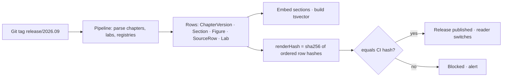

- Ingestion is idempotent per `gitSha`; a re-run of the same tag produces the same rows and hash.
- Migrations: Prisma Migrate, forward-only, one migration per PR; a release that needs a schema change ships the migration first, then the content.
- Seeding: development seeds from a fixture release built from three chapters (21, 28, 37) and their labs, plus rubric v1.2 and the four PRD worked examples as suggestions.
- Flow back: an accepted change opens branch `improve/S-36-0198` in the book repository through the pipeline's write key; CI runs the lab suite; a curator merges; the version bumps by the book's rule (patch for wording and figures, minor for a new section, major for structure); the next release tag re-runs ingestion. The SaaS never edits content rows outside this path.

## 5. Front end (Next.js)

The Book is the spine: Assistant, Labs and Improve are parallel routes rendered beside a chapter, never separate apps. Every screen in the UI package maps to one route below.

### 5.1 Route map (App Router)

| Route | Screen (UI package) | Rendering | Auth |
| --- | --- | --- | --- |
| `/[lang]` | Book-Home | RSC, cached by release | any |
| `/[lang]/paths` and `/[lang]/paths/[path]` | Book-Paths | RSC + client progress | signed in |
| `/[lang]/search?q=&part=&layer=&tier=&age=` | Book-Search | RSC, dynamic | any |
| `/[lang]/ch/[n]` and `/[lang]/ch/[n]/[section]` | Reader-Chapter, Mobile-Reader | RSC, cached by release; peek panel = intercepting route `(.)ref/[id]` | any |
| `/[lang]/ch/[n]/[section]/@assistant` | Assistant-Answer, Assistant-Refusal-Walk, Mobile-Assistant | parallel route slot; client component with SSE | signed in |
| `/[lang]/ch/[n]/@lab` and `/[lang]/labs/[labId]/runs/[runId]` | Labs-IDE | parallel route slot; client component with WebSocket | builder+; desktop and tablet only |
| `/[lang]/ch/[n]/@improve/new?anchor=` | Improve-Suggest | slot; client form with server actions | contributor+, verified |
| `/[lang]/improve/[suggestionId]` | Improve-Adjudication, Improve-Record | RSC | owner, curators |
| `/[lang]/improve/queue` | Curator-Queue | RSC + client detail pane | curator |
| `/[lang]/ch/[n]/history` | Chapter-History | RSC | any |
| `/[lang]/rubric` | Rubric | RSC, static per rubric version | any |
| `/[lang]/account` | Account-Admin | RSC + client forms | org admin (roster read-only for all) |
| `/api/v1/*` | — | route handlers (section 6) | per endpoint |

Mobile (< 768 px) renders `/ch` and `@assistant` only; `@lab` and `@improve` slots return a "desktop or tablet" notice, per the PRD's read-only mobile scope.

### 5.2 Component tree and data fetching

| Layer | Server components | Client components |
| --- | --- | --- |
| Chrome | TopBar, StatusBar, Outline, InstrumentPanel (chapter) | LangToggle, KeyboardMap, SearchBox |
| Reader | SectionBody (markdown → HTML at build of the release), FigureChip, DeriveChip, SourceTierChip, CodeBlock, MermaidFigure (SSR to SVG) | PeekPanel (intercepting route), CopyButton, OpenInLabs |
| Assistant | Dock shell, ConversationLog | Composer, AnswerStream (SSE), CitationChip, SensorVerdicts (disclosure), FlagButton, DecisionAidForm |
| Labs | LabShell, ChapterSidePanel | FileTree, Editor (CodeMirror 6), OutputPane (verdict + DiffTable), Terminal (WebSocket), SandboxStatusBar, RunHistory |
| Improve | RecordTimeline, AdjudicationResult, RubricTables, HistoryLedger | AnchorPicker, ProposedChange, EvidenceList (live grading), RationaleCounter, ScoreInstrument, QueueDetail, OverrideForm |
| Admin | Seats, Roster, RetentionNotice | BudgetMeter, ResidencySelect, AuditExportForm |

- Content requests are keyed by `releaseId` and served from the Next.js data cache with `revalidateTag(release)` on publish; a chapter is one query of `ChapterVersion` + `Section[]` + `Figure[]` + `SourceRow[]`.
- Markdown is rendered to HTML once, in the content pipeline, with the chip and derive-link markup already in place; the reader never parses markdown at request time.
- Assistant streaming: Server-Sent Events from `POST /api/v1/assistant/messages`; the stream carries tokens, then a final event with citations and sensor verdicts; the client renders "the book does not cover this" only from the final event, never from the token stream.
- IDE transport: one WebSocket per sandbox session for stdin/stdout, run status and resource metrics (bidirectional, sub-second). SSE would need a second channel for input.
- i18n: `next-intl` with message catalogues per locale; every string key carries a PT string at least 30 % longer than EN in the fixture, and a CI check fails a layout snapshot where a PT label truncates. Figures render from the same rows in both editions; number and date formatting follow the locale (1.000,5 · 12 set 2026).
- Accessibility per component: real `button`, `a`, `input` + `label`; `aria-current` on outline and nav; `aria-label` on icon-only controls; focus ring 2 px `--focus`; live regions for verdicts and stream completion; Mermaid figures carry alt text from the release; code blocks are labelled with file and lines.
- Keyboard map (from the style guide): `/` search, `j` `k` next and previous section, `g l` open lab, `a` ask about this section, `esc` close peek or dock, `[` `]` previous and next chapter, `?` this map.

### 5.3 State

| State | Lives in |
| --- | --- |
| Language, chapter, section, search filters, selected suggestion | URL |
| Release id, chapter content, rubric, roster | Server (data cache by release) |
| Conversation, run history, suggestion drafts | Server (PostgreSQL) via server actions |
| Editor buffer, terminal scrollback, dock open/closed, collapsed panels | Client memory; edited files are saved to object storage through `POST /labs/{id}/runs` and `PATCH /labs/{id}/files`, never kept in the sandbox |
| Remembered filters, last tab | `localStorage`, best effort |

### 5.4 Performance budgets (PRD §Non-functional · Performance)

| Budget | Mechanism |
| --- | --- |
| Chapter load < 1 s | Pre-rendered HTML per section, cached by release; RSC payload under 150 KB per chapter; fonts self-hosted with `font-display: swap` |
| Search < 500 ms | Single SQL: tsvector rank fused with pgvector cosine on the release's sections, GIN and HNSW indexes; filters as WHERE clauses; no re-rank on the search page |
| Assistant first token < 2 s | Retrieval and re-rank budget 600 ms; guide prefix byte-stable for provider prompt caching; small model for scope check in parallel with retrieval |
| Sandbox ready < 5 s | Warm pool of snapshot-restored microVMs per lab image; lab files mounted read-only from a pre-built image, user edits overlaid |

## 6. Back end

REST with an OpenAPI 3.1 contract generated from shared zod schemas; route handlers in the Next.js app; long-running work handed to Temporal. All endpoints sit under `/api/v1`, require a session or bearer token unless marked public, and pass OPA before touching data.

### 6.1 Endpoint catalogue

| Method · path | Auth · role | Request → response | Rate limit | Idempotency | Errors |
| --- | --- | --- | --- | --- | --- |
| `GET /releases/current` | public | → `{id, gitSha, renderHash, publishedAt}` | 600/min/IP | — | — |
| `GET /chapters?lang=` | public | → `ChapterCard[]` (status, version, lab verdict, stale flag) | 600/min/IP | — | — |
| `GET /chapters/{n}?lang=` | public | → `ChapterVersion` with sections, figures, source rows | 600/min/IP | — | 404 |
| `GET /sections/{id}?lang=` | public | → `Section` (peek payload) | 600/min/IP | — | 404 |
| `GET /figures/{id}/derive` | public | → `{labId, filePath, line, expression}` | 600/min/IP | — | 404, 409 not derived |
| `GET /search?q&part&layer&tier&age&type&lang` | public | → `{count, ms, hits[]}` | 120/min/IP | — | 400 |
| `GET /paths` · `PUT /paths/{path}/progress` | user | → progress | 60/min | PUT idempotent | 401 |
| `PUT /bookmarks/{sectionId}` · `DELETE` · `PUT /notes/{sectionId}` | user | → row | 60/min | idempotent | 401 |
| `POST /assistant/conversations` | user | `{chapter?, section?, lang}` → `{id}` | 30/min | — | 401, 429 |
| `POST /assistant/conversations/{id}/messages` (SSE) | user | `{text, mode, inputs?}` → token stream, final `{citations, verdicts, refusal?}` | 20/min, budget-gated | `Idempotency-Key` header | 402 budget cap, 422 out of scope (refusal is a 200 with `refusal`) |
| `POST /assistant/messages/{id}/flag` | user | `{reason}` → `{flagId}` | 10/min | one per message per user | 409 |
| `GET /assistant/conversations/{id}` | owner | → messages with verdicts | 60/min | — | 403 |
| `POST /labs/{labId}/sessions` | builder+ | → `{sessionId, wsUrl, readyMs, caps}` | 6/hour/user; 1 active | `Idempotency-Key` | 402 IDE minutes cap, 503 pool empty |
| `WS /labs/sessions/{id}` | session owner | stdin/stdout, `run`, `status`, `metrics` frames | — | — | close 4001 killed |
| `POST /labs/sessions/{id}/run` | owner | → `{runId}`; result via WS | 30/hour | `Idempotency-Key` | 409 already running |
| `POST /labs/sessions/{id}/reset` | owner | → `{restored: fileCount}` | 30/hour | idempotent | — |
| `PATCH /labs/{labId}/files` | owner | `[{path, content}]` → `[{path, sha256}]` | 120/hour | by sha | 413 > 1 MB |
| `POST /labs/runs/{runId}/save` · `POST /labs/runs/{runId}/share` | owner | → `{savedAt}` · `{url}` | 30/hour | idempotent | — |
| `DELETE /labs/sessions/{id}` | owner | → 204 (sandbox destroyed) | — | idempotent | — |
| `GET /rubric/current` · `GET /rubric/{version}` | public | → tiers, adjustments, thresholds, examples | 600/min | — | — |
| `POST /suggestions` | contributor, verified | `{anchor, changeClass?, proposed, rationale}` → `{id, changeClass, thresholds}` (draft) | 20/day | `Idempotency-Key` | 422 no anchor, 422 rationale > 200 words, 429 throttled |
| `POST /suggestions/{id}/evidence` | owner | `{kind, url \| doi \| uploadKey \| labRunId}` → `EvidenceItem` graded | — | — | — |
| `POST /suggestions/{id}/submit` | owner | → `{state, workflowId}` | 20/day | idempotent | 422 intake sensor named |
| `GET /suggestions/{id}` · `GET /suggestions/{id}/record` | owner, curator | → suggestion · ledger records with hashes | 120/min | — | 403 |
| `GET /curation/queue?class=&part=` | curator | → items with seeded flag hidden until decided | 120/min | — | 403 |
| `POST /curation/{suggestionId}/decision` | curator of that part | `{action, overrideCode?, note?}` → `{ledgerSeq}` | 60/hour | `Idempotency-Key` | 403 wrong part, 422 override without code |
| `GET /curation/metrics` | curator | → override rate per criterion, κ, precision | 60/min | — | — |
| `GET /chapters/{n}/history` | public | → version ledger, credits | 600/min | — | — |
| `GET /org` · `PATCH /org` | org admin | seats, caps, residency | 60/min | idempotent | 422 region not offered |
| `GET /org/members` · `PUT /org/members/{userId}` | org admin | role, seat | 60/min | idempotent | 409 no seats |
| `GET /org/budget?month=` | org admin | → tokens used, cap, by kind | 60/min | — | — |
| `POST /org/audit-exports` | org admin | `{scope, from, to}` → `{id, status}`; JSONL via signed URL | 4/day | `Idempotency-Key` | — |
| `POST /webhooks/ci` | HMAC | `{sha, labResults[]}` → 204 | — | by delivery id | 401 bad signature |
| `POST /webhooks/temporal` | mTLS | workflow state changes for notifications | — | by event id | — |

Error body everywhere: `{code, message, detail?, traceId}`; messages are declarative and name the fix, in the user's language.

### 6.2 Authorisation model (ch28)

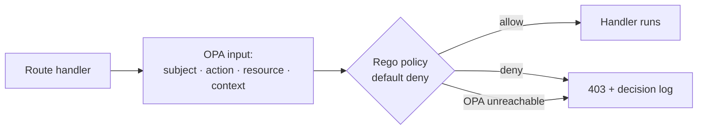

| Subject | May |
| --- | --- |
| reader | Read content, search, paths, bookmarks, notes, assistant |
| builder | reader + lab sessions, runs, saves, shares |
| contributor (verified) | builder + suggestions, evidence, own records |
| curator (per part) | contributor + queue for that part, decisions, overrides, metrics; curator-only change classes; rubric changes |
| org admin | reader + org, members, budget, exports, residency |
| agent (dual identity) | Acts as `service:adjudicator` on behalf of a suggestion id; may read anchored text, evidence metadata, sensor verdicts; may write only `Adjudication`, `CriterionVerdict`, `LedgerRecord(kind in decided)`; may never read `User` |

Curator-only classes are a policy rule, not application code: `changeClass == CURATOR_ALWAYS` denies `decision` to `service:adjudicator` and allows it only to a curator whose roster includes the chapter's part. Policy is versioned in Git with the rubric and loaded by OPA bundle; a failed bundle load keeps the last good bundle and alerts.

### 6.3 Budget enforcement at the gateway (ch23)

- Each organisation has one LiteLLM virtual key with `max_budget` set to the monthly cap in tokens converted to cost at pinned prices, and a per-key `tpm` limit. The gateway refuses the call before it reaches a provider; no application code counts tokens for enforcement.
- Labs declare model calls in their README (`Lab.declaresModelCalls`); a sandbox for such a lab receives a session-scoped sub-key with a per-run allowance; other sandboxes receive no key.
- Meter: every gateway response writes `BudgetLedger` (kind: assistant · grading · adjudication · lab) through the OTel pipeline; the Account-Admin meter and the IDE status bar read the same rows.
- At the cap: the assistant returns 402 with "Model budget reached for this organisation; resets 01 Oct"; model labs run without model calls and say so; adjudication of that organisation's suggestions is queued until reset (the 24-hour target still applies from reset).

### 6.4 Rate limits and the throttle rule

| Rule | Value | Enforced at |
| --- | --- | --- |
| Per-IP public reads | 600/min | Edge |
| Assistant messages | 20/min/user | Route handler (token bucket in PostgreSQL advisory row) |
| Lab sessions | 1 active, 6/hour/user | Route handler + orchestrator |
| Suggestions | 20/day/contributor | Route handler |
| Contributor throttle | 3 declines for unverifiable evidence (tier U) in a rolling 30 days → `throttledUntil = now + 30 days`; new suggestions return 429 with the reason; existing ones proceed | Temporal activity after each decision |
| Sandbox abuse | 2 kills for egress attempts in a session → session ended; 3 sessions in 30 days → account suspended for IDE, org admin notified | Orchestrator |

## 7. Sequence diagrams

Seven flows, each with its failure branches. The agent loop in every flow is plan · act · observe · verify · repair with caps (ch22); sensors run before any judgment (ch26).

### 7.1 Assistant answer (PRD §Capability 2)

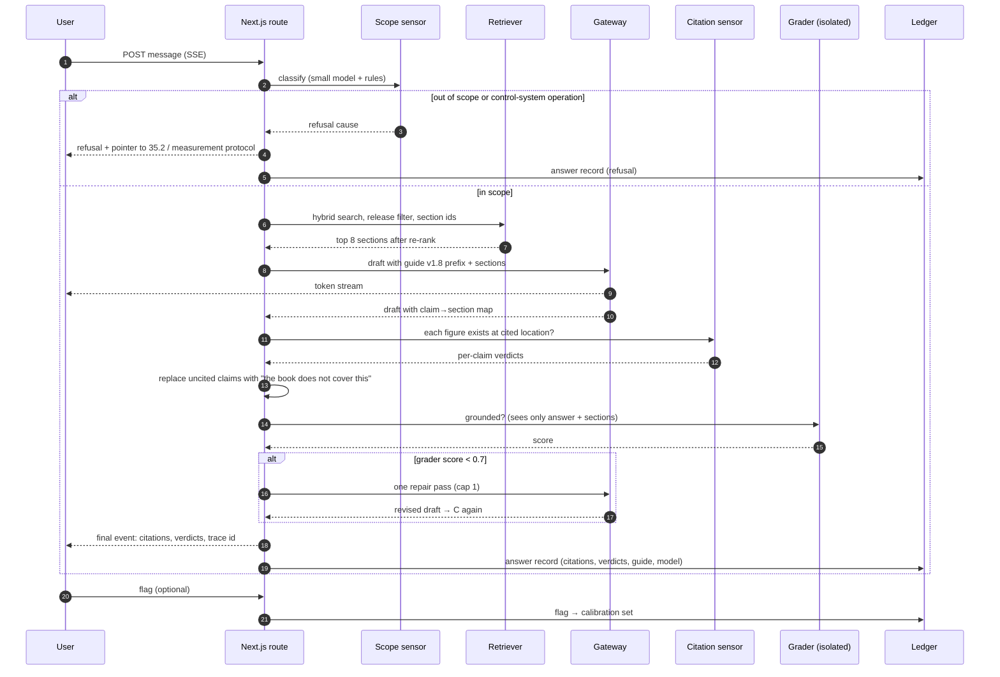

The token stream starts before the sensors finish; the client shows citations and substitutions only from the final event, so a user never sees an uncited claim presented as cited. One repair pass is the cap; a second failure ships the answer with the substitutions and a lower grader score in the log.

### 7.2 Decision-aid walk (PRD §Capability 2 · modes)

```mermaid
sequenceDiagram
  autonumber
  participant U as User
  participant W as Route
  participant A as Aid resolver
  participant X as Derive runner (sandbox, read-only)
  participant L as Ledger
  U->>W: mode walk, aid 37.8, inputs {2000, 11, 36.5%, 62%}
  W->>A: load aid schema (inputs, derive entry point)
  A-->>W: schema; validate inputs
  alt input outside declared range
    W-->>U: field error naming the range
  else valid
    W->>X: run derive.py --aid 37.8 with inputs
    X-->>W: {result 13×, line L142, prices verified 02 Sep 2026}
    W-->>U: step result + derive chip + source verification date
    W->>L: answer record (inputs, result, derive line)
  end
```

The model never computes; it explains a result the chapter's own script produced. The runner is the same sandbox image as the lab, started without a user shell and with no egress.

### 7.3 Lab run (PRD §Capability 3)

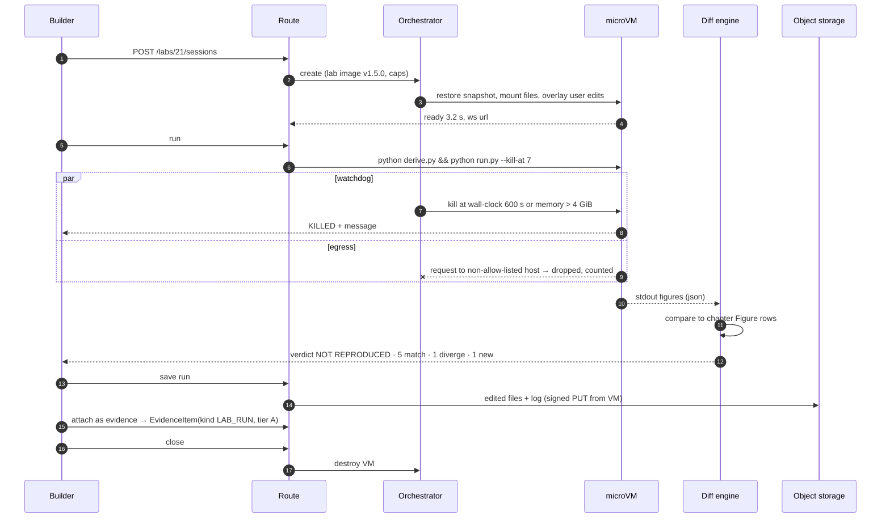

The verdict is computed outside the sandbox from the run's printed figures, so user code cannot forge a REPRODUCED. A kill produces a run record with `verdict = KILLED` and the message the Labs-IDE screen shows.

### 7.4 Suggestion adjudication (PRD §Capability 4)

```mermaid
sequenceDiagram
  autonumber
  participant C as Contributor
  participant W as Route
  participant T as Temporal workflow
  participant I as Intake sensors
  participant E as Evidence grader
  participant K as Consistency sensors
  participant A as Adjudicator (isolated)
  participant Q as Curator queue
  participant L as Ledger
  C->>W: submit S-23-0412
  W->>T: start SuggestionWorkflow
  T->>I: schema · anchor exists · evidence parses · rationale ≤ 200 words
  alt intake fails
    I-->>T: named sensor
    T->>L: declined at intake
    T-->>C: declined, sensor named
  else
    T->>E: grade each item (fetch, tier, adjustments)
    E-->>T: items; score = max + corroboration
    alt score < floor (tier G: 5 < 25)
      T->>L: declined at intake, no model call
      T-->>C: declined; tier B or D would suffice
    else
      T->>K: derive.py · cross-chapter · lint
      K-->>T: verdicts (WARN F-23-06 also at 37.4)
      alt change class curator-always
        T->>Q: route to curator (part)
      else
        T->>A: suggestion + evidence + verdicts + anchored text (no identity)
        A-->>T: decision + one reason per criterion (structured)
        alt accept and sensors pass
          T->>T: MergeWorkflow (7.6)
        else request more
          T-->>C: named tier
        else decline
          T-->>C: failing sensor or reason
        end
      end
      T->>L: graded · sensors · decided records
    end
  end
```

The grader runs before the adjudicator and a floor breach ends the flow before any frontier-model call; the PRD's tier-G example never costs an adjudication. The adjudicator's input is assembled by the workflow from ledger rows, never from the request.

### 7.5 Curator override (PRD §Capability 4 · override; ch31, ch32)

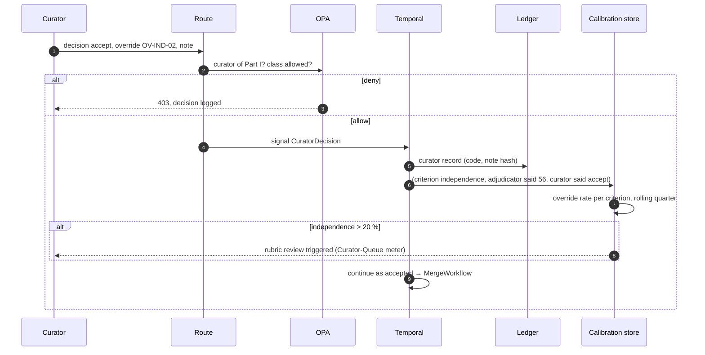

An override is one signal to the running workflow; the workflow, not the route handler, writes the ledger and updates calibration, so the record and the metric cannot diverge.

### 7.6 Accepted change to release (PRD §Capability 4 · merge; §Content pipeline)

```mermaid
sequenceDiagram
  autonumber
  participant T as MergeWorkflow
  participant G as Book Git repo
  participant CI as CI
  participant M as Curator
  participant P as Content pipeline
  participant L as Ledger
  T->>G: branch improve/S-36-0198, commit change + source row date
  G->>CI: lab suite
  CI-->>T: webhook: 34/35 reproduce; Lab 23 failure pre-existing, unrelated
  alt this chapter's lab fails
    T-->>M: blocked; suggestion returned as request more (updated lab run)
  else
    T-->>M: PR ready; version 1.3.2 → 1.3.3 (patch)
    M->>G: merge
    G->>CI: tag release
    CI->>P: ingest; compute renderHash
    P-->>T: hash equals CI hash
    T->>L: merged record (sha, version from→to, credit)
  end
```

A merge needs the chapter's own lab to reproduce; an unrelated pre-existing failure elsewhere in the suite does not block it, and the record says so.

### 7.7 Integrations

```mermaid
sequenceDiagram
  autonumber
  participant B as Browser
  participant N as Next.js
  participant K as Keycloak
  participant I as Customer IdP
  participant GW as Gateway
  participant T as Temporal
  participant S3 as Object storage
  rect rgb(240,240,236)
  note over B,I: SSO login
  B->>N: /login (org)
  N->>K: OIDC authorize
  K->>I: SAML / OIDC
  I-->>K: assertion
  K-->>N: id token (org, role claims)
  N-->>B: session cookie
  end
  rect rgb(240,240,236)
  note over N,GW: Gateway call with budget check
  N->>GW: chat (virtual key)
  alt budget remaining
    GW-->>N: completion + usage
  else cap reached
    GW-->>N: 402 budget_exceeded
  end
  end
  rect rgb(240,240,236)
  note over N,T: Curator approval signal
  N->>T: SignalWorkflow(CuratorDecision)
  T-->>N: ack; state query for the queue
  end
  rect rgb(240,240,236)
  note over N,S3: Audit export
  N->>T: ExportWorkflow(scope, range)
  T->>S3: JSONL + trailer, signed
  T-->>N: signed URL, 24 h
  end
```

Git release ingestion is 4.5's diagram. Each integration has one owner: identity is Keycloak's, budgets are the gateway's, state is Temporal's, files are object storage's.

## 8. AI agent specifications

Three agents, each a versioned guide with a byte-stable prefix, a structured output schema, sensors on both sides, and a calibration procedure (ch18, ch26, ch27).

|  | Assistant | Evidence grader | Adjudicator |
| --- | --- | --- | --- |
| Model tier (ch23) | Frontier for drafting; small for scope classification | Small (tier and relevance classification with the source opened) | Frontier |
| Guide | `guides/assistant/v1.8` | `guides/grader/v1.3` | `guides/adjudicator/v2.1` |
| Prefix order (byte-stable, cached) | 1 guide · 2 rubric of citation rules · 3 release id · 4 retrieved sections · 5 conversation · 6 question | 1 guide · 2 rubric v1.2 tiers and factors · 3 anchored claim · 4 evidence text | 1 guide · 2 rubric v1.2 thresholds · 3 anchored text · 4 proposed change · 5 graded evidence · 6 sensor verdicts |
| May read | Retrieved sections, conversation, decision-aid results | The evidence document as fetched, the anchored claim | Suggestion payload, evidence with grades, sensor verdicts, anchored text at current version |
| May never read | Anything outside the corpus; user identity | Contributor identity; other suggestions | Contributor identity beyond `verified: true`; other suggestions; curator notes |
| Output schema | `{claims:[{text, sectionId, figureId?}], refusal?: {cause}, mode_result?}` | `{tier, relevance: 1.0\|0.6\|0.2, recency, independence, reason ≤ 30 words}` | `{decision, criteria:[{name, verdict, reason ≤ 30 words}], sufficientTier?, failingSensor?}` |
| Sensors before | Scope classifier; unverified-chapter check | Fetch (200 or U); schema | Intake sensors; consistency sensors; change-class router |
| Sensors after | Citation sensor; edition sensor; grounding grader (isolated) | Score arithmetic recomputed in code, not taken from the model | Schema; decision consistent with thresholds (code recomputes accept/floor) |
| Cap | 1 repair pass | 1 attempt; failure = tier U with reason | 1 attempt; failure = curator queue |

Guides are files in the book repository under `guides/`, versioned with the rubric; a guide edit is a curator-only change and a release. Each prompt logs its guide version and model id (section 4.2 `Message.guideVersion`, `Adjudication.guideVersion`).

### 8.1 Calibration (ch12, ch27; PRD §Metrics)

| Agent | Reference set | Metric | Gate | Retirement |
| --- | --- | --- | --- | --- |
| Assistant grader | 300-question golden set + sampled flags, labelled by curators | κ against curator labels, quarterly | ≥ 0.7 to ship Phase 2 | A criterion below 0.6 is retired from the grader |
| Evidence grader | 100 curated suggestions with curator-assigned tiers | Agreement on tier and relevance | ≥ 0.7 | Same |
| Adjudicator | Curator overrides (calibration data) and seeded queue items | κ per criterion, quarterly; override rate per criterion | Override < 10 % target; > 20 % on one criterion triggers rubric review | Criterion below 0.6 retired |

Seeded items: the queue holds curator items with a known answer at a fixed share, indistinguishable to the curator until decided; the seeded flag is revealed in the record afterwards. Seeds measure curator consistency, not the adjudicator.

The current reading, from the Curator-Queue screen: adjudicator κ = 0.68 against curators for Q3 2026 (above the retirement floor, below the 0.7 gate), independence override rate 21.4 % (rubric review triggered).

## 9. Observability and audit

OTel GenAI semantic conventions on every model call, every sandbox session and every adjudication; hash-chained ledger for anything a person or an auditor will ask about later (ch29; PRD §Non-functional · Auditability).

| Event | Span attributes | Stored in |
| --- | --- | --- |
| Model call | `gen_ai.system`, `gen_ai.request.model` (pinned id), guide version, prompt hash, `gen_ai.usage.input_tokens` / `output_tokens`, cached tokens, cost, latency, organisation id, purpose (assistant · grading · adjudication · lab) | Langfuse + `BudgetLedger` |
| Sandbox session | vm id, lab, image version, ready ms, cpu %, memory, wall-clock, egress denials, kill reason | Grafana + `SandboxSession` |
| Adjudication | suggestion id, change class, score, decision, sensor verdicts, guide and rubric versions, cost | Ledger + Langfuse trace link |
| Assistant answer | message id, citations resolved / total, refusal cause, grader score, first token ms | Ledger + Langfuse |
| Policy decision | subject, action, resource, allow/deny, bundle version | OPA decision log → Loki |
| Curator action | action, override code, seeded, queue wait | Ledger |

Dashboards, one per PRD headline metric and one for leading indicators:

| Dashboard | Series |
| --- | --- |
| Weekly return rate | weekly active / monthly active accounts |
| Lab run rate | chapters with ≥ 1 run per active account per quarter, of 35 lab chapters |
| Assistant citation and flag rate | answers with a citation on every claim; flagged answers; refusal rate by cause |
| Adjudication precision | accepted suggestions later reverted / accepted |
| Leading indicators | suggestions per month by tier; request-more conversion; override rate per criterion with 10 % and 20 % lines; κ per quarter; verification age of fast-moving figures; cost per active account; sandbox kills per session |

Not collected, by design (PRD §What is not measured): time on page, messages per session, per-contributor counts as a ranking. The Chapter-History credit list is alphabetical and the schema has no leaderboard query.

Audit export: section 4.3's JSONL per organisation or per chapter, produced by a Temporal workflow, delivered by signed URL, itself recorded in the ledger as an `export` record.

## 10. Security and threat model

Five attacks the PRD names, each with the control the book describes, where it is detected, and what remains (ch25, ch28; PRD §Risks).

| Attack | Control | Chapter | Detection | Residual risk |
| --- | --- | --- | --- | --- |
| Prompt injection through evidence or tool output (an evidence page tells the grader to award tier A) | Fetched evidence enters the grader as fenced untrusted data; the grader's output is a classification, never an action; score arithmetic is recomputed in code; the adjudicator sees grades, not evidence text; no agent holds a tool that writes content | ch25, ch28 (CaMeL, Rule of Two) | Injection canaries in the calibration set; grader outputs that cite instructions in the evidence are flagged | A persuasive but honest-looking source can still be over-graded on relevance; curators sample accepted tier-B items monthly |
| Sandbox abuse (mining, egress attempts, host escape) | Firecracker microVM per session; 2 vCPU, 4 GiB, 10-minute wall clock; default-deny egress; no inbound; destroyed on close; no route to the data tier | ch25 | Egress denial counter; CPU at cap with no lab output; repeated kills | Allow-listed registries can be abused for slow exfiltration; volume caps per session |
| Evidence gaming (tier-B citation that does not say what is claimed) | Relevance graded with the source opened; unreachable link graded U; misattribution recorded against the contributor; throttle after three U declines | ch27, ch31 | Curator monthly sample; override rate on relevance | Paywalled sources cannot be opened and fall to U; contributors may upload the document instead |
| Secret leakage into model-visible text | Provider keys only in the gateway; per-account virtual keys only in workers; user lab keys only in the sandbox env, never logged; secret scanner on prompt templates in CI and on logged prompts | ch25, ch28 | Scanner count must be zero; alert on any hit | A user pasting a secret into the assistant is logged for 30 days; the scanner redacts on ingestion |
| Tenant isolation failure | `organisationId` on every account-scoped row; Prisma client extension adds the tenant filter to every query; OPA denies cross-tenant reads; signed URLs scoped per object | ch28 | Integration tests that attempt cross-tenant reads for every endpoint; OPA decision log | A bug in a raw SQL path bypasses the extension; raw SQL is reviewed and listed |
| Assistant answers outside the book | Scope refusal by construction; citation sensor; uncited claims substituted; flags to calibration | ch20, ch26 | Citation rate dashboard; flag rate | Fluent answers inside scope with a wrong section cited; sampled audit |

Fail-closed everywhere a decision is made: OPA unreachable denies; gateway unreachable refuses the model call; sandbox orchestrator unreachable refuses the session; CI webhook signature failure discards the result.

## 11. Testing, CI/CD and environments

The lab suite is the regression gate (ch27): no release ships unless every lab reproduces in the sandbox tier and the render hash matches.

| Level | What | Tooling | Gate |
| --- | --- | --- | --- |
| Unit | Score arithmetic (strongest item + corroboration, all four PRD worked examples as fixtures); hash chain; threshold routing; change-class detection; diff engine | Vitest | 100 % of rubric branches |
| Contract | Every `/api/v1` endpoint against the OpenAPI schema; error bodies; rate-limit headers | Vitest + generated client | No untyped endpoint |
| Policy | Rego unit tests per role × action × class, including cross-tenant and agent identity | OPA test | All deny cases |
| Integration | Suggestion workflow end to end with Temporal test server; assistant flow with a stub gateway; sandbox create/run/kill against a local Firecracker host | Testcontainers | Green on every PR |
| End to end | The 18 screens' primary flows in PT and EN; keyboard map; PT label truncation snapshots; WCAG 2.2 AA with axe | Playwright | No AA violation |
| Golden sets | 300 assistant questions (citation rate ≥ 90 %); 100 curated suggestions (precision < 3 %, override < 10 %) | Inspect-style runner via the gateway | Phase gates |
| Lab suite | All 35 labs in the sandbox tier; each prints its figures; diff engine verdicts | CI matrix | 35/35 REPRODUCED (34 today; Lab 23 open) |
| Load | Chapter load, search, assistant first token, sandbox ready against section 5.4 budgets at 20 pilot accounts × 10 | k6 | p95 within budget |

Environments: `dev` (fixture release of chapters 21, 28, 37; stub gateway; local Firecracker), `staging` (full release, real gateway with a test budget, small sandbox pool), `prod` (São Paulo). Content promotion is a tag; code promotion is a merge to `main` with a canary of 10 % for one hour.

Release procedure: migrate (forward-only) → deploy code → ingest content tag → compare render hash → switch `Release.current` → revalidate the data cache. Rollback: point `Release.current` at the previous release id (content rows are immutable, so this is instant); code rollback by redeploying the previous image; migrations are never rolled back, so every migration is additive until the following release removes the old column.

## 12. Open decisions and assumptions

The PRD's open questions, with the assumption this TRD builds on until they are decided.

| Question (PRD §Open questions) | Assumption used here | What changes if decided otherwise |
| --- | --- | --- |
| Pricing model: seats, individual tier, or usage-metered | Organisational seats with a token cap and IDE-minute cap per organisation; individual accounts get a fixed small cap | Usage metering needs per-user `BudgetLedger` rows and per-user gateway keys; the schema already keys ledger rows by organisation and `ref`, so this is additive |
| Contributor compensation or recognition beyond credit | Credit in chapter history only; no payment rails | Payments add a finance integration and a tax-identity field that the ledger must not carry |
| Curator roster for Part I | Two curators listed (H. Okafor, J. Brandão) as placeholders in the roster screen; the policy requires two per part before Phase 4 opens that part's queue | None to the architecture |
| Print edition cadence | No print pipeline; releases are Git tags | A print pipeline consumes the same release; nothing in the SaaS changes |
| Second region for EU customers | Brazil only; EU shown disabled | A second deployment of every container in the boundary plus per-organisation residency routing at the edge; the schema's `Residency` enum gains a value |

Decisions this document made that the PRD left open, for review: REST over tRPC (6); WebSocket for the IDE and SSE for the assistant (5.2); one ledger chain for the whole product rather than one per chapter (4.3); score arithmetic and threshold routing in code, never taken from a model (8); Lab 23's current failure treated as pre-existing and non-blocking for other chapters' merges (7.6).
