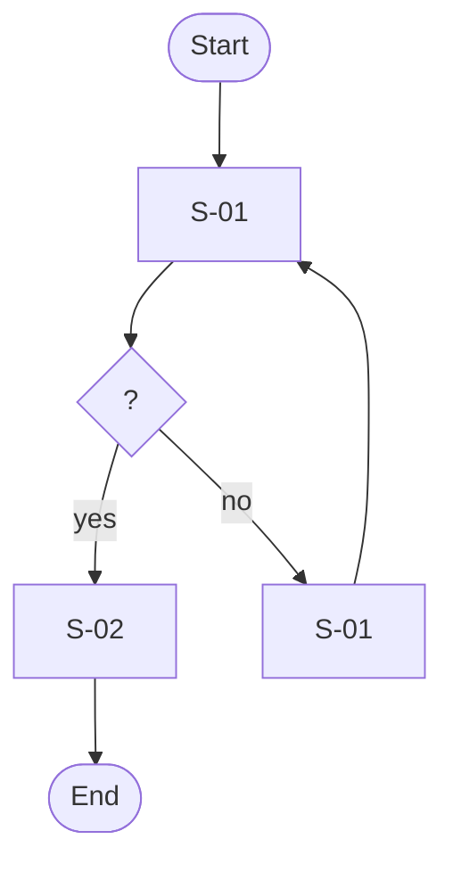

# PRD — <Product name>

<Mon D, YYYY> · v1.0 · mode <new|amendment|as-built> · traces to research `docs/research/<brief>.md`

## Summary

<One or two paragraphs: what the product is, for whom, and the one outcome it exists for.>

Product kind: <ui | service | ui_and_service>

| Capability | What the user does | What the system guarantees |
| --- | --- | --- |
| <Capability name> | <action> | <a statement a test could falsify> |

## Problem and goals

<The problem, with facts from the research report and their sources.>

| Goal | Target | Measure |
| --- | --- | --- |
| <goal> | <number with unit> | <how it is counted, over what window> |

Non-goals: <what the product will not do>.

## Principles

| Article | Principle | Compliance check |
| --- | --- | --- |
| P-1 | <rule every spec must satisfy> | <conformance check: what it asserts \| Code health threshold \| review question: the question> |

## Users and personas

| Persona | Who | Primary use | Must have |
| --- | --- | --- | --- |
| <Persona, as named in research> | <role and context> | <what they do with the product> | <the one thing it must give them> |

### User roles

| Role | Personas | Permissions | Never |
| --- | --- | --- | --- |
| <role-id> | <Persona> | <Object: create, read, update, delete> | <what the role may never do> |

### Jobs to be done

| Job | Role | When | I want to | So I can | Success number | Requirements |
| --- | --- | --- | --- | --- | --- | --- |
| JTBD-1 | <role-id> | <situation> | <action> | <outcome> | <number that proves the outcome> | FR-1.1 |

## Journeys and screens

### User journey flowchart

### Screens map

| Screen | Name | Purpose | Roles | Objects | Leads to |
| --- | --- | --- | --- | --- | --- |
| S-01 | <Name> | <why it exists> | <role-id> | <Object> | S-02 |

### Service blueprint

| Step | Screen | Frontstage | Backstage | Support system | Failure point | Recovery | Requirements |
| --- | --- | --- | --- | --- | --- | --- | --- |
| B-1 | S-01 | <what the user sees or does> | <what the product does out of sight> | <external system, or none> | <what can go wrong, or none> | <how the service recovers> | FR-1.1 |

## Objects

| Object | Definition | Owner role | States | Retention | Personal data |
| --- | --- | --- | --- | --- | --- |
| <Object> | <one sentence> | <role-id> | <state → state> | <period> | <yes or no> |

### <Object>

| Field | Type | Required | Format | Example |
| --- | --- | --- | --- | --- |
| <field> | <type> | <yes or no> | <format or unit> | <real example> |

## Capability 1 — <Name>

<What the capability is, what it is modelled on, and what it is not.>

Features:

- `<feature-slug>` — <one line>

Requirements:

- FR-1.1: <behaviour, its condition, the observable outcome>
- FR-1.2: <what the system refuses, and what it does instead>
- FR-1.3: <a requirement with a number>

Success criteria:

- SC-1 (`<feature-slug>`): <an observable result a scenario can check>

Limits: <what this capability does not do in this release>.

Screens: S-01, S-02

## Architecture

| Product component | Pattern | Role |
| --- | --- | --- |
| <component> | <pattern or reference> | <what it is responsible for> |

<Source of truth, tenancy and residency in two or three sentences.>

## Non-functional requirements

| Area | Requirement |
| --- | --- |
| Security | <requirement with a number or a named standard> |
| Privacy | <…> |
| Performance | <…> |
| Availability | <…> |
| Accessibility | <…> |
| Auditability | <…> |
| Cost control | <…> |

## Metrics and success criteria

| Metric | Definition | Target |
| --- | --- | --- |
| <metric> | <numerator / denominator, window> | <number> |

What is not measured: <metric and the reason it would mislead>.

## Scope, phases, and release plan

| Phase | Ships | Gate |
| --- | --- | --- |
| 1 — <name> | <capabilities> | <numeric gate to the next phase> |

Out of scope for the first release: <list>.

Dependencies: <what must exist before phase 1 starts>.

## Risks and open questions

| Risk | Mitigation |
| --- | --- |
| <risk> | <control, where it is detected, and the consequence> |

Open questions:

- <a choice with its options?>
