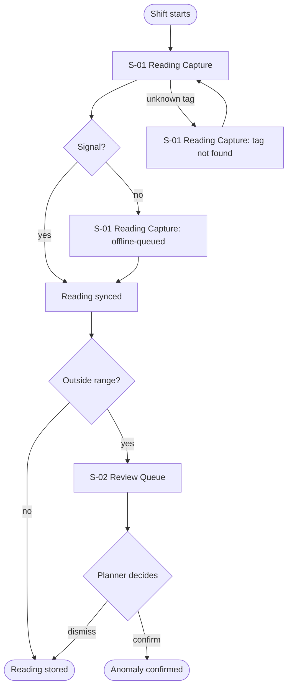

# PRD — Reading Capture

Nov 11, 2026 · v1.0 · mode new · traces to research `docs/research/reading-capture.md`

Fictional exemplar: the product and its numbers are invented to show the shape.

## Summary

Reading Capture lets field inspectors record meter readings on site, with or without signal, and shows maintenance planners the abnormal ones the same day. It replaces a paper form retyped into a spreadsheet, where 12% of readings change on the way.

Product kind: ui_and_service

| Capability | What the user does | What the system guarantees |
| --- | --- | --- |
| Reading capture | Records a reading against an asset on a phone | A reading saved on the device is never lost: it reaches the server exactly once, or the inspector sees it as unsent |
| Anomaly review | Reviews readings flagged as abnormal and confirms or dismisses each | Every reading outside its asset type's range is flagged within 5 min of sync; no flag is closed without a named planner |

## Problem and goals

Inspectors write readings on paper and retype them at the end of the shift; 12% of retyped readings differ from the form (`docs/research/reading-capture.md`, Findings), and planners see abnormal values 2 days late. Plant rooms on 3 of 5 sites have no signal, so a tool that needs a connection is not used.

| Goal | Target | Measure |
| --- | --- | --- |
| Readings are entered once | ≥ 95% of readings captured on the phone | readings created in the product / readings in the monthly audit sample |
| Planners see anomalies the same day | ≥ 90% of anomalies reviewed within 24 h of capture | anomalies with a decision ≤ 24 h after `captured_at` / anomalies flagged, 30-day window |
| Transcription errors disappear | ≤ 1% of readings differ from the meter in the audit | audit mismatches / audited readings, quarterly |

Non-goals: work-order management; editing the asset list; reading meters automatically; any use outside the company's own sites.

## Principles

| Article | Principle | Compliance check |
| --- | --- | --- |
| P-1 | A reading is never silently dropped | conformance check: every reading the API acknowledges has a stored row |
| P-2 | The Asset Registry is the only source of assets; this product never writes to it | conformance check: only the registry client calls the Asset Registry, and only to read |
| P-3 | Every change to a reading keeps the original value and the person who changed it | review question: does the diff write to `reading` without a `reading_revision` row? |
| P-4 | Capture works with gloves on a 360 px phone | review question: is every new target on S-01 ≥ 44 × 44 px? |

## Users and personas

| Persona | Who | Primary use | Must have |
| --- | --- | --- | --- |
| Field Inspector | Walks plant rooms with a company Android phone, often offline | Records every reading on the shift's route | Saving a reading with no signal in ≤ 3 taps |
| Maintenance Planner | Desk role that plans work from readings | Reviews abnormal readings the same day | A queue of flagged readings with the asset's range beside each |

### User roles

| Role | Personas | Permissions | Never |
| --- | --- | --- | --- |
| inspector | Field Inspector | Reading: create, read own; Asset: read | Change a synced reading; see another inspector's readings |
| planner | Maintenance Planner | Reading: read, correct; Anomaly: read, decide; Asset: read | Create a reading; delete anything |

### Jobs to be done

| Job | Role | When | I want to | So I can | Success number | Requirements |
| --- | --- | --- | --- | --- | --- | --- |
| JTBD-1 | inspector | I am at an asset with no signal | record its reading in a few taps | finish the route without retyping | ≤ 3 taps and ≤ 20 s per reading | FR-1.1, FR-1.2 |
| JTBD-2 | planner | a reading is outside its range | see it with the asset's history | decide today whether to raise work | decision ≤ 24 h after capture for ≥ 90% | FR-2.1, FR-2.3 |

## Journeys and screens

### User journey flowchart

### Screens map

| Screen | Name | Purpose | Roles | Objects | Leads to |
| --- | --- | --- | --- | --- | --- |
| S-01 | Reading Capture | Record a reading against an asset, online or offline | inspector | Reading, Asset | S-01 |
| S-02 | Review Queue | Decide each flagged reading | planner | Anomaly, Reading, Asset | S-02 |

### Service blueprint

The service once the product exists. Above the line of visibility is what the inspector or planner sees; below it, what the product and its support systems do.

| Step | Screen | Frontstage | Backstage | Support system | Failure point | Recovery | Requirements |
| --- | --- | --- | --- | --- | --- | --- | --- |
| B-1 | S-01 | Inspector opens the app; today's assets are already on the phone | The asset mirror is refreshed nightly, read-only | Asset Registry | Registry unreachable at refresh | Keep the last mirror and show its date on S-01 | FR-1.4 |
| B-2 | S-01 | Inspector types the tag and value and saves | The reading is stored on the phone before any network call | none | Tag not in the asset list | Save refused, value kept, "Tag not found. Check the tag or ask your planner." | FR-1.1, FR-1.4 |
| B-3 | S-01 | The reading shows as Unsent, then Synced | The queue sends it within 60 s of the connection returning | none | No signal in the plant room | Reading stays offline-queued on the phone until it syncs | FR-1.2 |
| B-4 | S-01 | Nothing new: the reading stays Synced | The server stores the reading once, by id | none | The same reading sent twice | The second call gets the first result | FR-1.3 |
| B-5 | — | Out of sight | A range check creates an anomaly within 5 min; a model writes a one-sentence summary | Model provider | Summary fails or takes more than 10 s | Anomaly shown with "Summary unavailable" | FR-2.1, FR-2.2 |
| B-6 | S-02 | Planner confirms or dismisses each anomaly | The decision is stored with the planner's id and the time | none | Another role tries to decide | Decision refused; the anomaly stays open | FR-2.3 |
| B-7 | S-02 | Planner corrects a misread value | The original value is kept and the range is checked again | none | none | — | FR-2.4 |

## Objects

| Object | Definition | Owner role | States | Retention | Personal data |
| --- | --- | --- | --- | --- | --- |
| Reading | One value read from one asset's meter at one time | inspector | queued → synced → corrected | 5 years | yes |
| Asset | A piece of equipment with a meter, as listed in the Asset Registry | planner | active → retired | mirrors the registry | no |
| Anomaly | A flag on a reading outside its asset type's range | planner | open → confirmed or dismissed | 5 years | yes |

### Reading

| Field | Type | Required | Format | Example |
| --- | --- | --- | --- | --- |
| id | uuid | yes | UUID v7, created on the device | 0192f3a1-7c4e-7b2a-9d1e-3f5a6b7c8d9e |
| asset_tag | string | yes | 3 letters, dash, 4 digits | PMP-0412 |
| value | decimal | yes | up to 3 decimals, in the asset's unit | 7.25 |
| captured_at | datetime | yes | ISO 8601 with offset, device clock | 2026-11-11T08:42:10-03:00 |
| inspector_id | string | yes | the inspector's user id | u_1042 |

### Asset

| Field | Type | Required | Format | Example |
| --- | --- | --- | --- | --- |
| tag | string | yes | 3 letters, dash, 4 digits | PMP-0412 |
| type | string | yes | registry asset type | pump |
| unit | string | yes | SI unit symbol | bar |
| range_min | decimal | yes | in the asset's unit | 4.0 |
| range_max | decimal | yes | in the asset's unit | 9.0 |

### Anomaly

| Field | Type | Required | Format | Example |
| --- | --- | --- | --- | --- |
| id | uuid | yes | UUID v7 | 0192f3a1-9a11-7c00-8e2f-1a2b3c4d5e6f |
| reading_id | uuid | yes | a Reading id | 0192f3a1-7c4e-7b2a-9d1e-3f5a6b7c8d9e |
| summary | string | yes | ≤ 200 characters, generated | 7.25 bar is 0.4 above this pump's 30-day mean |
| decision | enum | no | confirmed or dismissed | confirmed |
| decided_by | string | no | the planner's user id | u_2007 |

## Capability 1 — Reading capture

The inspector scans or types an asset tag, enters the value and saves. The reading is stored on the device first and synced when a connection exists. It is modelled on RouteLog's offline queue (`docs/research/reading-capture.md`, Competitors and references); it is not a general form builder.

Features:

- `capture-reading` — record a reading against a known asset
- `offline-queue` — keep readings on the device and sync them once

Requirements:

- FR-1.1: When the inspector saves a reading, the system stores it on the device before any network call and shows it in the day's list within 1 s.
- FR-1.2: When the device has no connection, the system marks the reading offline-queued and syncs it within 60 s of the connection returning, without the inspector acting.
- FR-1.3: When the same reading id is sent twice, the server stores it once and answers the second call with the first result.
- FR-1.4: When the asset tag is not in the asset list, the system refuses the save, keeps the typed value on screen and shows "Tag not found. Check the tag or ask your planner."
- FR-1.5: The system never lets an inspector change a reading after it has synced.

Success criteria:

- SC-1 (`offline-queue`): A reading saved with no connection appears on the server exactly once after the connection returns.
- SC-2 (`capture-reading`): An inspector records a reading for a known asset in ≤ 3 taps after the tag is entered.
- SC-3 (`capture-reading`): A reading with an unknown tag is not saved and the message names the next step.

Limits: one reading per asset per save; no photos; no bulk import.

Screens: S-01

## Capability 2 — Anomaly review

Every synced reading is compared with its asset's range. A reading outside the range becomes an anomaly with a one-line summary written by a model from the asset's last 30 days of readings, and waits in the planner's queue. The model summarises; it never decides.

Features:

- `flag-anomaly` — flag a reading outside its asset's range
- `review-queue` — confirm or dismiss each flagged reading

Requirements:

- FR-2.1: When a synced reading is below `range_min` or above `range_max` of its asset, the system creates an anomaly within 5 min.
- FR-2.2: For each anomaly the system generates a summary of ≤ 200 characters that states the value, the unit and the difference from the 30-day mean; when generation fails or exceeds 10 s, the anomaly is shown without a summary and marked "Summary unavailable".
- FR-2.3: The planner confirms or dismisses each anomaly; the decision stores the planner's id and the time, and the system refuses a decision from any other role.
- FR-2.4: When a planner corrects a reading's value, the system keeps the original value and re-checks the range.

Success criteria:

- SC-4 (`flag-anomaly`): A reading outside its asset's range appears in the review queue within 5 min of sync.
- SC-5 (`flag-anomaly`): An anomaly's summary states the value, the unit and the difference from the 30-day mean.
- SC-6 (`review-queue`): A decision by an inspector is refused and the anomaly stays open.
- SC-7 (`review-queue`): A planner sees each open anomaly with its asset's range and can confirm or dismiss it.

Limits: ranges come from the Asset Registry; no trend detection inside the range; no notifications in this release.

Screens: S-02

## Architecture

| Product component | Pattern | Role |
| --- | --- | --- |
| Capture client | Offline-first client with a local queue | Stores readings on the device and syncs them once |
| Readings service | Idempotent write API | Accepts each reading id once; owns readings and revisions |
| Anomaly worker | Background job | Compares readings with ranges; requests summaries |
| Asset mirror | Read-through cache | Serves the asset list from the Asset Registry |

The Asset Registry is the source of truth for assets; this product is the source of truth for readings and anomalies. Single tenant; all data stays in the company's region.

## Non-functional requirements

| Area | Requirement |
| --- | --- |
| Security | Every endpoint requires a signed session; roles are checked server-side on every call; 0 secrets in the client bundle |
| Privacy | Inspector and planner ids are personal data under LGPD; readings are kept 5 years, then deleted within 30 days |
| Performance | Save on device ≤ 1 s at p95; sync call ≤ 500 ms at p95; review queue loads ≤ 2 s at p95 with 500 open anomalies |
| Availability | 99.5% monthly for the readings service; capture keeps working during any outage |
| Accessibility | WCAG 2.2 AA; touch targets ≥ 44 × 44 px on S-01; state never shown by colour alone |
| Auditability | Every reading, correction and decision keeps who, when and the previous value for 5 years |
| Cost control | Summary generation ≤ USD 0.002 per anomaly at p95; ≤ 1 model call per anomaly |

## Metrics and success criteria

| Metric | Definition | Target |
| --- | --- | --- |
| Phone capture share | readings created in the product / readings in the monthly audit sample | ≥ 95% |
| Same-day review | anomalies decided ≤ 24 h after capture / anomalies flagged, 30 days | ≥ 90% |
| Lost readings | readings saved on a device that never reach the server, per month | 0 |

What is not measured: readings per inspector per hour — it rewards speed over a correct tag.

## Scope, phases, and release plan

| Phase | Ships | Gate |
| --- | --- | --- |
| 1 — Capture | Capability 1 on one site | 500 readings captured with 0 lost and ≤ 1% audit mismatches |
| 2 — Review | Capability 2 on the same site | ≥ 90% of anomalies decided within 24 h over 2 weeks |

Out of scope for the first release: iOS, photos, notifications, work orders, editing ranges.

Dependencies: read access to the Asset Registry API; company Android phones enrolled; a named planner and 3 inspectors for the pilot.

## Risks and open questions

| Risk | Mitigation |
| --- | --- |
| A device is lost with unsent readings | The day's list shows unsent readings in a separate group; a reading unsent for 24 h raises an alert to the planner; the count is a weekly metric |
| A generated summary misstates the value | The summary is checked by code against the reading's value and unit before it is stored; a mismatch drops the summary and counts as a failure in the monthly eval |
| Registry ranges are wrong for some asset types | Dismissed anomalies per asset type are reported monthly; a type above 50% dismissed is sent to the registry owner |

Open questions:

- Should a planner be able to reopen a dismissed anomaly, or is a new reading required?
