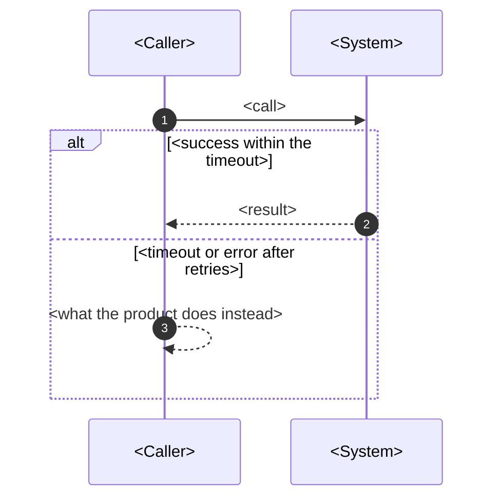

# TRD — <Product name>

<Mon D, YYYY> · v1.0 · mode <new|amendment|as-built> · traces to PRD v<x.y> (`docs/prd/<product>.md`)

## 1. Purpose, scope, phases

<The product in one sentence. Each phase adds one capability on the previous phase's components and must not pull forward components the next phase owns.>

| Phase | Adds | Gate |
| --- | --- | --- |
| <1 — name> | <architecture increment> | <numeric gate from the PRD> |

Traceability rule for this document: every section names the PRD capability, non-functional row or screen it serves. A section that only restates the PRD is deleted.

## 2. Stack

Serves: PRD §<heading>; PRD §Non-functional requirements · <area>.

| Choice | Pick | Alternatives | Why |
| --- | --- | --- | --- |
| <layer> | <language, framework, version> | <what was rejected> | <the constraint that decided it, with its PRD id> |

```json stack_profile
{
  "product_kind": "<ui|service|ui_and_service>",
  "repositories": [
    {
      "repository": "<owner/name>",
      "template": "<template id, new products only>",
      "languages": ["<language@version>"],
      "package_manager": "<name@version>",
      "base_image": "<image from an allowed source>",
      "quality": {
        "format": "<command>",
        "lint": "<command>",
        "typecheck": "<command>",
        "test": "<command>",
        "focused_test_pattern": "<command with {files}>"
      },
      "boundary_check": "<tool>",
      "bindings": "<framework>",
      "scanners": "<scanner set>",
      "load_test": "<tool>"
    }
  ],
  "guardrail_requests": []
}
```

Guardrail requests: <none | each need outside the factory guardrails, with its reason>

## 3. C4 diagrams

Serves: PRD §Users and personas; PRD §Architecture.

<Count the top-level pieces in one sentence.>

### 3.1 System context

```mermaid
C4Context
  title <Product> — system context
  Person(<id>, "<Persona as the PRD names it>", "<what they do>")
  System(<id>, "<Product>", "<one line>")
  System_Ext(<id>, "<External system as research names it>", "<one line>")
  Rel(<from>, <to>, "<verb>", "<protocol>")
```

### 3.2 Containers

```mermaid
C4Container
  title <Product> — containers
  System_Boundary(<id>, "<Product (region)>") {
    Container(<id>, "<Name>", "<technology>", "<responsibility>")
    ContainerDb(<id>, "<Name>", "<technology>", "<what it stores>")
  }
  Rel(<from>, <to>, "<verb>", "<protocol and port>")
```

### 3.3 Components

```mermaid
C4Component
  title <Core container> — components
  Container_Boundary(<id>, "<Container>") {
    Component(<id>, "<name>", "<technology>", "<responsibility>")
  }
  Rel(<from>, <to>, "<verb>")
```

## 4. Component map

Serves: PRD §Architecture; PRD §Principles (<P-n>).

| Component | Repository | Folder | Responsibility | May import | Never imports |
| --- | --- | --- | --- | --- | --- |
| <name> | <owner/name> | `<folder/>` | <one line> | `<folder/>` | `<folder/>` |

### 4.1 Invariants

| ID | Invariant | Check | Serves |
| --- | --- | --- | --- |
| INV-1 | <a statement that holds on every commit> | `evals/tech/invariants/<file>` | <P-n, FR-n.m> |
| INV-2 | <…> | `evals/tech/<…>` | <…> |
| INV-3 | <…> | `evals/tech/<…>` | <…> |
| INV-4 | <…> | `evals/tech/<…>` | <…> |

## 5. Network topology

Serves: PRD §Non-functional requirements · Security, Privacy.

<Zones, and the default stance for anything not listed.>


| From | To | Protocol · port | Auth | Notes |
| --- | --- | --- | --- | --- |
| <source> | <target> | <protocol · port> | <auth> | <note> |
| Anything else | Anywhere | any | — | Denied and logged |

<Environments, regions, residency and the egress allow-list.>

## 6. Data model (MER)

Serves: PRD §Objects.

```mermaid
erDiagram
  PARENT ||--o{ CHILD : "<verb>"
  PARENT {
    <type> <name> PK
    <type> <name>
  }
  CHILD {
    <type> <name> PK
    <type> <name> FK
  }
```

| Entity | PRD object | Keys | Indexes | Retention |
| --- | --- | --- | --- | --- |
| <entity> | <Object> | <PK, FK> | <indexes> | <period> |

## 7. Data flow

Serves: PRD §Objects; PRD §Non-functional requirements · Privacy.

| Object | Created | Stored | Sent to | Deleted | Personal data |
| --- | --- | --- | --- | --- | --- |
| <Object> | <where and by what> | <entity> | <who receives it, and which fields> | <the job or rule that deletes it> | <yes or no> |

## 8. Endpoint map

Serves: PRD §Capability <N> — <Name>.

| Method | Path | Roles | Request | Response | Errors | Idempotency | Rate limit | Serves |
| --- | --- | --- | --- | --- | --- | --- | --- | --- |
| <GET> | `</v1/path>` | <role-id> | `<TypeIn>` or — | `<TypeOut>` | <codes> | <rule> | <limit> | <FR-n.m> |

### 8.1 Types

```ts
type <TypeIn> = { <field>: <type> };
type <TypeOut> = { <field>: <type> };
```

## 9. Integration sequences

Serves: PRD §Capability <N> — <Name> (<FR-n.m>); research §Customer blueprint (<system>).

| Integration | System | Direction | Auth | Timeout | Retries |
| --- | --- | --- | --- | --- | --- |
| <name> | <System as research names it> | <in or out> | <auth> | <seconds> | <count and backoff> |



## 10. AI orchestration and protocols

Serves: PRD §Capability <N> — <Name> (<FR-n.m>); PRD §Non-functional requirements · Cost control.

| Call | Model tier | Prompt | May read | May never read | Tools | Output schema | Checks before | Checks after | Cap |
| --- | --- | --- | --- | --- | --- | --- | --- | --- | --- |
| <call_id> | <fast, strong or top> | `<path to the prompt>` | <inputs> | <what is withheld> | <tools or none> | `<Schema { field: type }>` | <preconditions> | <validation of the output> | <tokens, seconds, calls, cost> |

| Protocol | Used for | Auth |
| --- | --- | --- |
| <protocol> | <which call or tool> | <auth> |

## 11. MLOps

Serves: PRD §Non-functional requirements · <area>.

| Call | Reference set | Metric | Gate | Cadence | Drift monitor | Retirement |
| --- | --- | --- | --- | --- | --- | --- |
| <call_id> | <size and location> | <what is measured> | <numeric gate> | <when it runs> | <signal and threshold> | <rule for removing it> |

Versioning: <how prompts, models and datasets are versioned and recorded>.

## 12. DevOps

Serves: PRD §Non-functional requirements · Availability, Performance.

| Environment | Purpose | Deploys from | Data |
| --- | --- | --- | --- |
| staging | <purpose> | <trigger> | <data> |
| prod | <purpose> | <trigger> | <data> |

Pipeline: <stage → stage → stage>.

Rollback: <the one command or act, and its time in minutes>.

| SLO | Alert | Threshold |
| --- | --- | --- |
| <objective from a PRD NFR row> | <signal> | <number and window> |

## 13. Security and threat model

Serves: PRD §Non-functional requirements · Security; PRD §User roles.

| Threat | Path | Control | Check |
| --- | --- | --- | --- |
| <what could go wrong> | <where> | <the control> | <the test, invariant or scenario that proves it> |

| Secret | Lives in | Reachable by |
| --- | --- | --- |
| <secret> | <store> | <which container only> |

## 14. Testing

Serves: PRD §Metrics and success criteria.

| Layer | What | Where | Runs |
| --- | --- | --- | --- |
| Acceptance bindings | <non-manual scenarios> | Holdout `tests/acceptance/features/` | <when> |
| Conformance checks | <invariants and import contracts> | `evals/tech/` | Every PR |
| Unit and integration | <component behaviour> | `tests/unit/`, `tests/integration/` | Every PR |

## 15. Open decisions and assumptions

| Decision | Options | Assumed | Owner | Needed by |
| --- | --- | --- | --- | --- |
| <decision> | <option · option> | <the option this document assumes> | <role> | <phase> |
