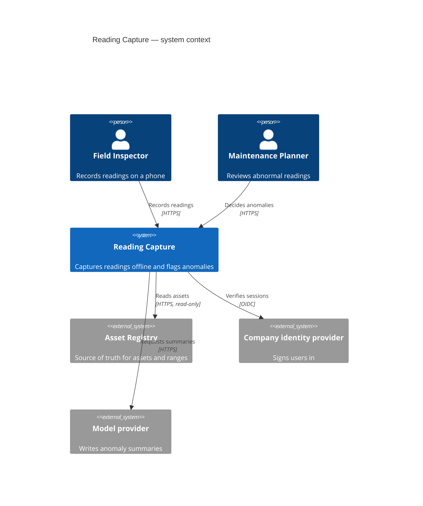
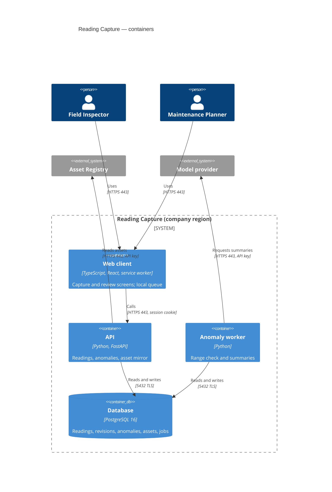
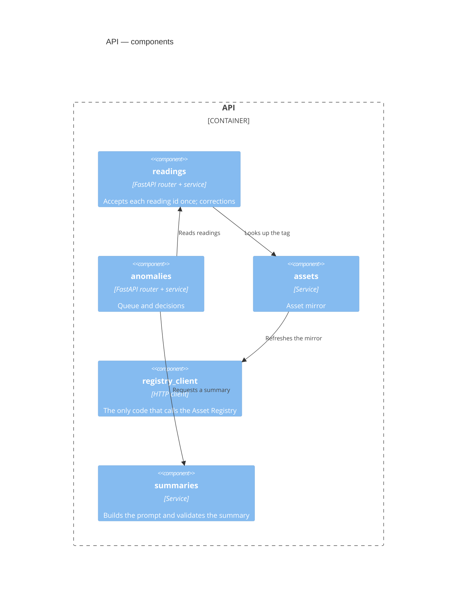
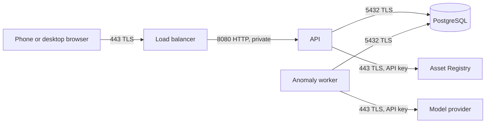
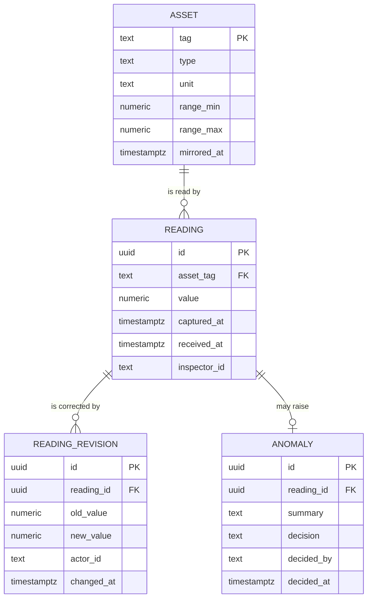
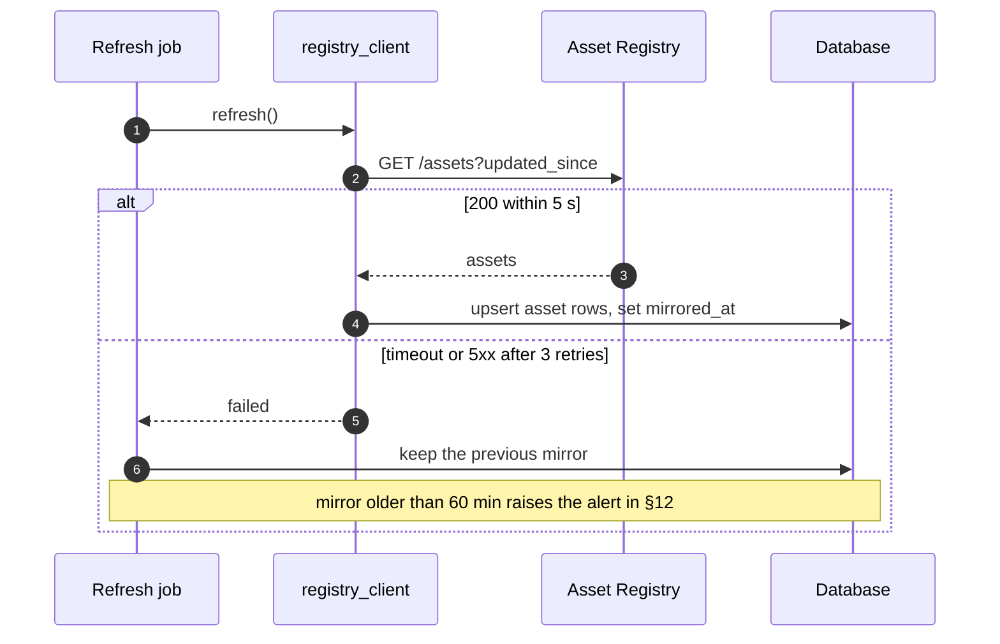
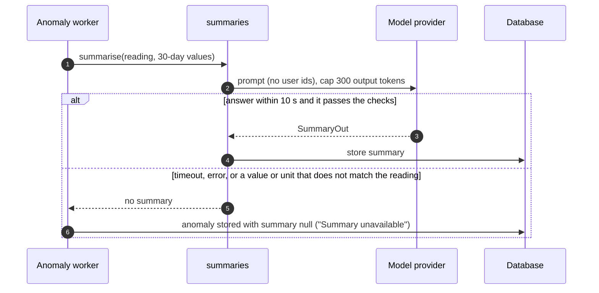

# TRD — Reading Capture

Nov 11, 2026 · v1.0 · mode new · traces to PRD v1.0 (`docs/prd/reading-capture.md`)

Fictional exemplar: the product, hosts and numbers are invented to show the shape.

## 1. Purpose, scope, phases

Reading Capture is an offline-first web client for inspectors and a review queue for planners, backed by one API and one database. Each phase adds one capability on the previous phase's components and must not pull forward components the next phase owns.

| Phase | Adds | Gate |
| --- | --- | --- |
| 1 — Capture | Web client with the sync queue; readings API; asset mirror | 500 readings captured with 0 lost and ≤ 1% audit mismatches |
| 2 — Review | Anomaly worker; summaries; review queue | ≥ 90% of anomalies decided within 24 h over 2 weeks |

Traceability rule for this document: every section names the PRD capability, non-functional row or screen it serves. A section that only restates the PRD is deleted.

## 2. Stack

Serves: PRD §Architecture; PRD §Non-functional requirements · Performance, Availability.

| Choice | Pick | Alternatives | Why |
| --- | --- | --- | --- |
| Client | TypeScript 5.6, React, a service worker with IndexedDB | Native Android app | Company phones run a managed browser; offline capture (FR-1.2) needs only a service worker and local storage |
| API | Python 3.12, FastAPI | TypeScript on Node | The anomaly worker and summaries share Python data tooling; both are supported stacks |
| Database | PostgreSQL 16 | SQLite | Unique constraints and transactions carry INV-1 and INV-2; two writers (API, worker) |
| Jobs | A Postgres-backed queue in the API repository | A separate broker | One fewer service for ≤ 2,000 readings per day |

```json stack_profile
{
  "product_kind": "ui_and_service",
  "repositories": [
    {
      "repository": "fieldco/reading-web",
      "template": "typescript-web",
      "languages": ["typescript@5.6"],
      "package_manager": "pnpm@9",
      "base_image": "registry.example/approved/node:22-bookworm",
      "quality": {
        "format": "pnpm format:check",
        "lint": "pnpm lint",
        "typecheck": "pnpm typecheck",
        "test": "pnpm test",
        "focused_test_pattern": "pnpm vitest run {files}"
      },
      "boundary_check": "dependency-cruiser",
      "bindings": "playwright",
      "scanners": "typescript-default",
      "load_test": "k6"
    },
    {
      "repository": "fieldco/reading-api",
      "template": "python-service",
      "languages": ["python@3.12"],
      "package_manager": "uv@0.4",
      "base_image": "registry.example/approved/python:3.12-slim",
      "quality": {
        "format": "ruff format --check",
        "lint": "ruff check",
        "typecheck": "mypy .",
        "test": "pytest",
        "focused_test_pattern": "pytest {files}"
      },
      "boundary_check": "import-linter",
      "bindings": "pytest-bdd",
      "scanners": "python-default",
      "load_test": "k6"
    }
  ],
  "guardrail_requests": []
}
```

Guardrail requests: none. Both registries and both base-image sources are inside the factory guardrails.

## 3. C4 diagrams

Serves: PRD §Users and personas; PRD §Architecture.

One web client, one API, one worker, one database.

### 3.1 System context



The Asset Registry is only ever read. The model provider receives one reading and 30 days of values, never a user id.

### 3.2 Containers



Users reach only the web client and the API. Only the API holds the registry key and only the worker holds the model key.

### 3.3 Components



## 4. Component map

Serves: PRD §Architecture; PRD §Principles (P-1, P-2, P-3).

| Component | Repository | Folder | Responsibility | May import | Never imports |
| --- | --- | --- | --- | --- | --- |
| capture | fieldco/reading-web | `src/capture/` | S-01 screen and ReadingForm | `src/sync/`, `src/api/`, `src/ui/` | `src/review/` |
| review | fieldco/reading-web | `src/review/` | S-02 screen, AnomalyTable, DecisionButtons | `src/api/`, `src/ui/` | `src/capture/`, `src/sync/` |
| sync | fieldco/reading-web | `src/sync/` | Local queue in IndexedDB; sends each reading once | `src/api/` | `src/capture/`, `src/review/` |
| api-client | fieldco/reading-web | `src/api/` | Typed client for §8 | — nothing in `src/` | `src/capture/`, `src/review/`, `src/sync/` |
| ui | fieldco/reading-web | `src/ui/` | Token variables and shared controls | — nothing in `src/` | `src/capture/`, `src/review/`, `src/sync/`, `src/api/` |
| readings | fieldco/reading-api | `app/readings/` | Idempotent write; corrections with revisions | `app/assets/`, `app/db/` | `app/anomalies/`, `app/summaries/`, `app/integrations/` |
| anomalies | fieldco/reading-api | `app/anomalies/` | Range check, queue, decisions | `app/readings/`, `app/assets/`, `app/summaries/`, `app/db/` | `app/integrations/` |
| assets | fieldco/reading-api | `app/assets/` | Asset mirror | `app/integrations/registry/`, `app/db/` | `app/readings/`, `app/anomalies/` |
| registry_client | fieldco/reading-api | `app/integrations/registry/` | The only caller of the Asset Registry; GET only | — nothing in `app/` | everything else in `app/` |
| summaries | fieldco/reading-api | `app/summaries/` | Prompt, model call, validation | `app/db/` | `app/anomalies/`, `app/readings/` |
| db | fieldco/reading-api | `app/db/` | Migrations, sessions, the job queue | — nothing in `app/` | everything else in `app/` |

### 4.1 Invariants

| ID | Invariant | Check | Serves |
| --- | --- | --- | --- |
| INV-1 | Every reading the API acknowledges with 2xx has a row in `reading` | `evals/tech/invariants/test_inv_1_no_silent_drop.py` | P-1, FR-1.1 |
| INV-2 | A reading id is stored at most once; a repeat returns the first result | `evals/tech/invariants/test_inv_2_idempotent_write.py` | FR-1.3 |
| INV-3 | Only `app/integrations/registry/` calls the Asset Registry, and only with GET | `evals/tech/invariants/test_inv_3_registry_read_only.py` | P-2 |
| INV-4 | Every change to `reading.value` writes a `reading_revision` row with the old value and the actor | `evals/tech/invariants/test_inv_4_revision_on_correction.py` | P-3, FR-2.4 |
| INV-5 | `app/summaries/` never imports decision code, so a model output cannot close an anomaly | `evals/tech/boundaries/importlinter.ini` | FR-2.3 |

## 5. Network topology

Serves: PRD §Non-functional requirements · Security, Privacy.

Three zones: public, application, data. Default stance: deny; everything not listed below is closed.



| From | To | Protocol · port | Auth | Notes |
| --- | --- | --- | --- | --- |
| Browser | Load balancer | HTTPS · 443 | Session cookie (OIDC) | TLS ends at the load balancer |
| Load balancer | API | HTTP · 8080 | Private network only | No public address on the API |
| API | PostgreSQL | TCP · 5432 | TLS, role `api_rw` | — |
| Anomaly worker | PostgreSQL | TCP · 5432 | TLS, role `worker_rw` | Cannot write `reading.value` |
| API | Asset Registry | HTTPS · 443 | API key | Egress allow-list: `registry.example` |
| Anomaly worker | Model provider | HTTPS · 443 | API key | Egress allow-list: `api.model.example` |
| Anything else | Anywhere | any | — | Denied and logged |

Environments: `staging` and `prod`, one region, the company's. All data stays in that region; the model provider is outside it by nature and receives no personal data (§7).

## 6. Data model (MER)

Serves: PRD §Objects.



| Entity | PRD object | Keys | Indexes | Retention |
| --- | --- | --- | --- | --- |
| asset | Asset | PK `tag` | `type` | Mirrors the registry; refreshed every 15 min |
| reading | Reading | PK `id`; FK `asset_tag` | `(asset_tag, captured_at)` | 5 years, then deleted within 30 days |
| reading_revision | Reading | PK `id`; FK `reading_id` | `reading_id` | With its reading |
| anomaly | Anomaly | PK `id`; FK `reading_id` unique | `decision` where null | 5 years |

## 7. Data flow

Serves: PRD §Objects; PRD §Non-functional requirements · Privacy, Auditability.

| Object | Created | Stored | Sent to | Deleted | Personal data |
| --- | --- | --- | --- | --- | --- |
| Reading | On the phone (IndexedDB), then `POST /v1/readings` | `reading`, `reading_revision` | The model provider receives value, unit and 30 days of values, never `inspector_id` | Nightly job `purge_readings` deletes rows older than 5 years | yes |
| Asset | Asset Registry | `asset` (mirror) | Web client | Replaced on each refresh | no |
| Anomaly | Anomaly worker | `anomaly` | Web client | Deleted with its reading by `purge_readings` | yes |

## 8. Endpoint map

Serves: PRD §Capability 1 — Reading capture; PRD §Capability 2 — Anomaly review.

| Method | Path | Roles | Request | Response | Errors | Idempotency | Rate limit | Serves |
| --- | --- | --- | --- | --- | --- | --- | --- | --- |
| POST | `/v1/readings` | inspector | `ReadingIn` | `ReadingOut` | 401, 403, 422 `tag_not_found` | By `id`: a repeat returns the first `ReadingOut` | 120 per min per user | FR-1.1, FR-1.3, FR-1.4 |
| GET | `/v1/readings` | inspector (own), planner | — | `ReadingList` | 401, 403 | Safe | 60 per min per user | FR-1.1 |
| PATCH | `/v1/readings/{id}` | planner | `ReadingCorrection` | `ReadingOut` | 401, 403, 404 | By `id` and `value` | 30 per min per user | FR-1.5, FR-2.4 |
| GET | `/v1/assets` | inspector, planner | — | `AssetList` | 401 | Safe | 60 per min per user | FR-1.4 |
| GET | `/v1/anomalies` | planner, inspector (read) | — | `AnomalyList` | 401, 403 | Safe | 60 per min per user | FR-2.1 |
| POST | `/v1/anomalies/{id}/decision` | planner | `DecisionIn` | `AnomalyOut` | 401, 403, 404, 409 `already_decided` | By `id`: a repeat with the same decision returns the first result | 60 per min per user | FR-2.3 |

### 8.1 Types

```ts
type ReadingIn = { id: string; asset_tag: string; value: string; captured_at: string };
type ReadingOut = ReadingIn & { received_at: string; inspector_id: string; status: "synced" | "corrected" };
type ReadingList = { items: ReadingOut[]; next: string | null };
type ReadingCorrection = { value: string; reason: string };
type Asset = { tag: string; type: string; unit: string; range_min: string; range_max: string };
type AssetList = { items: Asset[]; mirrored_at: string };
type AnomalyOut = { id: string; reading: ReadingOut; asset: Asset; summary: string | null;
  decision: "confirmed" | "dismissed" | null; decided_by: string | null; decided_at: string | null };
type AnomalyList = { items: AnomalyOut[]; next: string | null };
type DecisionIn = { decision: "confirmed" | "dismissed" };
```

Decimals travel as strings so no client rounds a reading.

## 9. Integration sequences

Serves: PRD §Capability 1 — Reading capture (FR-1.4); PRD §Capability 2 — Anomaly review (FR-2.2); research §Customer blueprint (Asset Registry).

| Integration | System | Direction | Auth | Timeout | Retries |
| --- | --- | --- | --- | --- | --- |
| Asset mirror refresh | Asset Registry | out, GET only | API key | 5 s | 3 with backoff 1, 2, 4 s |
| Anomaly summary | Model provider | out | API key | 10 s | 1 |





## 10. AI orchestration and protocols

Serves: PRD §Capability 2 — Anomaly review (FR-2.2); PRD §Non-functional requirements · Cost control.

One model call. It writes one sentence and decides nothing.

| Call | Model tier | Prompt | May read | May never read | Tools | Output schema | Checks before | Checks after | Cap |
| --- | --- | --- | --- | --- | --- | --- | --- | --- | --- |
| anomaly_summary | fast | `app/summaries/prompt.md`, versioned | The reading's value and unit; the asset type; 30 days of values for that asset | User ids; other assets; free text from users | none | `SummaryOut { text: string ≤ 200 chars; value: string; unit: string; delta_from_mean: string }` | Reading is outside its range; ≥ 5 values in the 30 days | `value` and `unit` equal the reading's; `delta_from_mean` equals the computed difference to 2 decimals; length ≤ 200 | 300 output tokens; 10 s; 1 call per anomaly; USD 0.002 at p95 |

| Protocol | Used for | Auth |
| --- | --- | --- |
| HTTPS JSON with structured output | The summary call | API key held only by the worker |

## 11. MLOps

Serves: PRD §Non-functional requirements · Cost control; PRD §Risks and open questions (summary misstates the value).

| Call | Reference set | Metric | Gate | Cadence | Drift monitor | Retirement |
| --- | --- | --- | --- | --- | --- | --- |
| anomaly_summary | 200 anomalies with a planner-approved summary, in `evals/summaries/reference.jsonl` | Share of outputs that pass the checks-after and state the correct delta | ≥ 98% before any prompt or model change ships | On every prompt or model change, and monthly | Weekly share of anomalies stored with summary null; alert above 5% | Removed if the null share stays above 10% for 4 weeks; the queue works without summaries |

Versioning: the prompt file, the model alias and the reference set each carry a version recorded on every anomaly row's `summary_version`.

## 12. DevOps

Serves: PRD §Non-functional requirements · Availability, Performance, Auditability.

| Environment | Purpose | Deploys from | Data |
| --- | --- | --- | --- |
| staging | Acceptance bindings, load test, security checks | Every merge to `main` | Synthetic readings; a registry sandbox |
| prod | Live use | A release tag, after the release gates | Real readings |

Pipeline: format → lint → typecheck → unit and integration tests → conformance checks (`evals/tech/`) → scanners → build image → deploy to staging → acceptance bindings.

Rollback: redeploy the previous image tag with one command; ≤ 10 min; database migrations are additive, so the previous image runs on the new schema.

| SLO | Alert | Threshold |
| --- | --- | --- |
| API availability 99.5% monthly | Error-budget burn | 2% of the monthly budget in 1 h |
| Sync call ≤ 500 ms at p95 | Latency | p95 > 500 ms for 10 min |
| Review queue ≤ 2 s at p95 | Latency | p95 > 2 s for 10 min |
| Anomaly flagged ≤ 5 min after sync | Worker lag | Oldest unchecked reading > 5 min |
| Asset mirror fresh | Mirror age | `mirrored_at` older than 60 min |

Logs, metrics and traces carry the request id and the reading id; no log line carries a reading's value together with a user id.

## 13. Security and threat model

Serves: PRD §Non-functional requirements · Security, Privacy; PRD §User roles.

| Threat | Path | Control | Check |
| --- | --- | --- | --- |
| An inspector decides an anomaly | `POST /v1/anomalies/{id}/decision` | Role check in the router; 403 | Scenario `@SC-6` |
| A reading is replayed to create duplicates | `POST /v1/readings` | Unique `id`; repeat returns the first result | INV-2 |
| The product writes to the registry | `registry_client` | GET-only client; import contract | INV-3 |
| A summary carries personal data to the model | `summaries` | The prompt builder receives no user field | Unit test on the prompt builder's inputs |
| A stolen phone holds unsent readings | IndexedDB | Device encryption (company policy); the queue holds no credentials | Manual release check |

| Secret | Lives in | Reachable by |
| --- | --- | --- |
| Registry API key | Secret store | API only |
| Model API key | Secret store | Anomaly worker only |
| Session signing key | Secret store | API only |

## 14. Testing

Serves: PRD §Metrics and success criteria; PRD success criteria SC-1 to SC-7.

| Layer | What | Where | Runs |
| --- | --- | --- | --- |
| Acceptance bindings | The feature files' non-manual scenarios, through the UI and the API | Holdout `tests/acceptance/features/` | Per unit in the full suite; per release on staging |
| Conformance checks | INV-1 to INV-5 and the import contracts | `evals/tech/` | Every PR |
| Unit and integration | Component behaviour | `tests/unit/`, `tests/integration/` in each repository | Every PR |
| Load | Sync ≤ 500 ms at p95 at 20 readings per second | `ops/load/` (k6) | Per release on staging |
| Manual | `@manual` scenarios, on a 360 px phone with gloves | Release test pack | Per release |

## 15. Open decisions and assumptions

| Decision | Options | Assumed | Owner | Needed by |
| --- | --- | --- | --- | --- |
| Reopening a dismissed anomaly | Allow reopen · require a new reading | Require a new reading | Product owner | Phase 2 |
| Mirror refresh interval | 5 min · 15 min · 60 min | 15 min, within the registry's 60 requests per minute | Tech lead | Phase 1 |
